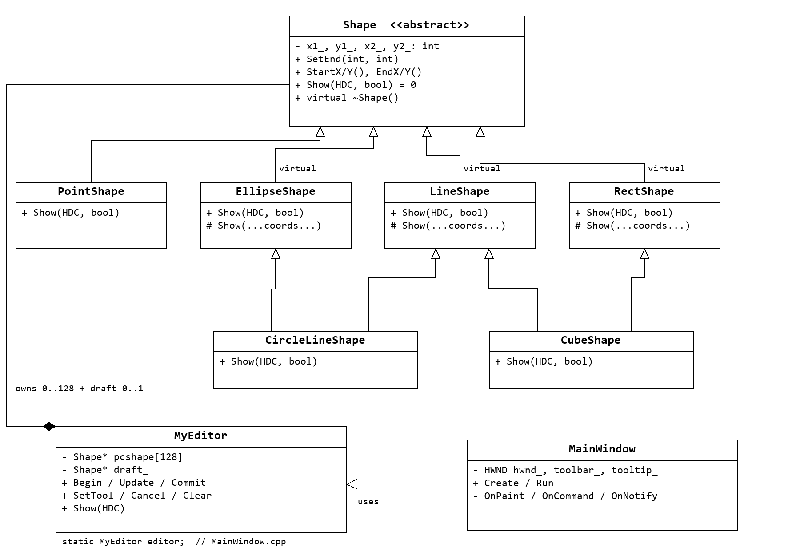
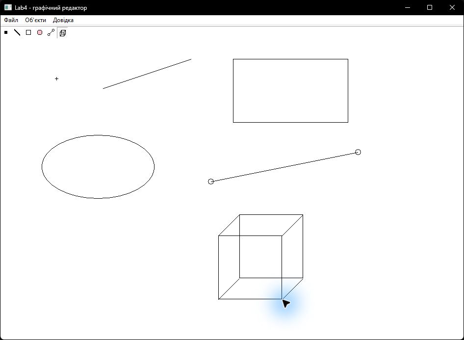
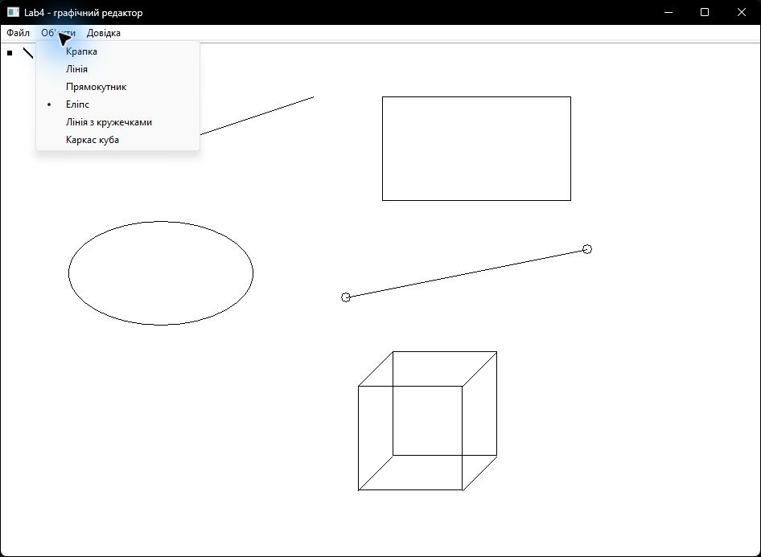
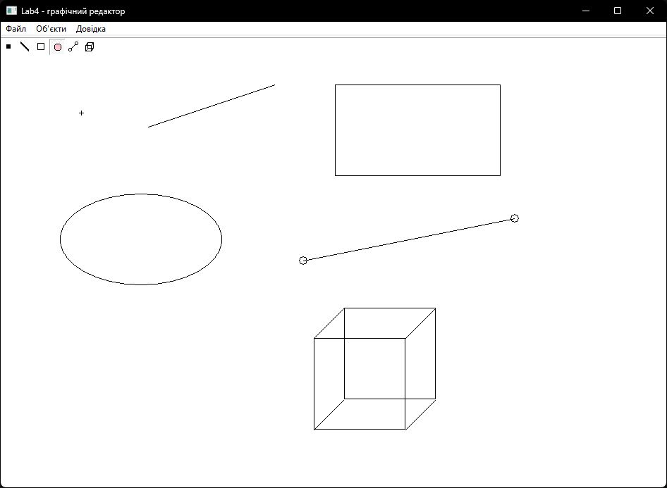

МІНІСТЕРСТВО ОСВІТИ І НАУКИ УКРАЇНИ  
НАЦІОНАЛЬНИЙ ТЕХНІЧНИЙ УНІВЕРСИТЕТ УКРАЇНИ  
«КИЇВСЬКИЙ ПОЛІТЕХНІЧНИЙ ІНСТИТУТ ІМЕНІ ІГОРЯ СІКОРСЬКОГО»  
Факультет інформатики та обчислювальної техніки  
Кафедра обчислювальної техніки  
  
ЗВІТ  
до лабораторної роботи №4  
з дисципліни «Об’єктно-орієнтоване програмування»  
Вдосконалення структури коду графічного редактора об’єктів  
  
Виконав студент групи ІМ-53  
Школа Михайло Володимирович  
Варіант №27  
Перевірив Рекечинський Д. О.  
  
Київ 2026

---

# 1 Мета роботи

Отримати навички проєктування класів та модернізувати графічний редактор в об’єктно-орієнтованому стилі, щоб нові типи об’єктів можна було додавати без переписування загального алгоритму малювання і зберігання фігур.

# 2 Завдання для варіанта №27

Номер у журналі 27 є непарним, тому редактор реалізовано як глобальний статичний об’єкт класу MyEditor. Проєкт Lab4 створено на основі Lab3. Редактор підтримує крапку, лінію, прямокутник, еліпс, лінію з кружечками на кінцях і каркас куба. Дві нові фігури реалізовано множинним успадкуванням.

У пам’яті зберігається до 128 завершених фігур у масиві Shape* pcshape[kCapacity], де kCapacity = 128. Прямокутник задається протилежними кутами, еліпс задається центром і кутом охоплюючого прямокутника. Обидві фігури мають чорний контур без заповнення. Крапка зображається хрестиком, як у попередньому проєкті. Нові фігури також чорні, без заповнення. Гумовий слід усіх шести фігур пунктирний.

Поточний тип фігури позначається в меню та на Toolbar. Кожна з шести кнопок має піктограму та українську підказку. Після WM_PAINT усі фігури відновлюються з даних у пам’яті. Вихід з програми звільняє створені об’єкти та GDI-ресурси.

# 3 Аналіз Lab3 та виконані зміни

У Lab3 вже були абстрактний Shape, чотири класи фігур, MyEditor, MainWindow, меню, Toolbar і допоміжні класи для безпечної роботи з GDI. Цю структуру збережено. Обробники миші створюють чернетку, змінюють її кінцеву координату та після відпускання кнопки додають об’єкт до масиву.

Основні зміни: Draw перейменовано на Show; редактор винесено з поля MainWindow у глобальний статичний об’єкт; додано CircleLineShape і CubeShape; меню та Toolbar розширено з чотирьох до шести інструментів. Параметр preview тепер визначає стиль пера. Оригінальні файли Lab3 залишено без змін.

У фактичному коді Lab3 еліпс мав рожеве заповнення. У Lab4 застосовано NULL_BRUSH відповідно до окремо заданої вимоги еліпса без заповнення.

# 4 Архітектура і множинне успадкування

Shape зберігає приватні координати початку та кінця, надає метод SetEnd і методи читання координат. Його Show є чисто віртуальним, а деструктор віртуальним. Через вказівник Shape* редактор викликає Show конкретного нащадка та правильно видаляє об’єкт незалежно від його типу.

```cpp
#pragma once
#include "LineShape.h"
#include "EllipseShape.h"

class CircleLineShape : public LineShape, public EllipseShape {
public:
    CircleLineShape(int x, int y) : Shape(x, y), LineShape(x, y), EllipseShape(x, y) {}
    void Show(HDC dc, bool preview = false) const override;
};

#pragma once
#include "LineShape.h"
#include "RectShape.h"

class CubeShape : public LineShape, public RectShape {
public:
    CubeShape(int x, int y) : Shape(x, y), LineShape(x, y), RectShape(x, y) {}
    void Show(HDC dc, bool preview = false) const override;
};
```

Віртуальне успадкування залишає одну спільну базу Shape у кожній складеній фігурі. Найпохідніші класи явно ініціалізують цю базу у своїх конструкторах. Таким чином, немає двох наборів координат і неоднозначного перетворення в Shape*.

CircleLineShape::Show викликає LineShape::Show для основної лінії та двічі EllipseShape::Show для кружечків радіуса 6 пікселів. CubeShape::Show двічі викликає RectShape::Show для квадратних граней і чотири рази LineShape::Show для ребер між ними. Захищені перевантаження Show приймають координати окремої частини, тому вихідні координати об’єкта не змінюються під час малювання.

Сторона передньої грані куба дорівнює меншому з модулів переміщення миші по X та Y. Задня грань зміщена вправо та вгору на третину сторони. Отримується квадратна передня грань і видимий каркас з двох граней та чотирьох ребер.

MyEditor володіє фігурами й чернеткою. Begin створює фігуру через звичайний switch, Update змінює кінець, Commit переносить чернетку в масив, Cancel видаляє чернетку, Clear видаляє всі об’єкти. MainWindow керує вікном і передає події глобальному редактору. Динамічного створення MyEditor немає.

```cpp
static MyEditor editor; // на рівні файлу MainWindow.cpp
```

Для гумового сліду Show отримує preview = true і створює перо PS_DOT. WM_MOUSEMOVE оновлює координати й викликає InvalidateRect, а WM_PAINT заново відображає завершені фігури та поточну чернетку. Попередній контур зникає після очищення фону. XOR-малювання не потрібне. TRANSPARENT зберігає видимими фігури під проміжками пунктиру.

# 5 UML діаграма класів



Рисунок 1. Успадкування, володіння фігурами та використання глобального редактора

Порожній трикутник вказує на базовий клас. Позначка virtual означає віртуальне успадкування Shape. Заповнений ромб позначає володіння фігурами, пунктирна стрілка — використання глобального редактора класом MainWindow. Позначення +, - та # означають public, private та protected.

# 6 Робота програми

Після вибору інструмента потрібно натиснути ліву кнопку миші на полотні, перетягнути мишу та відпустити кнопку. Для крапки достатньо клацання. Вибір нового інструмента скасовує незавершену чернетку. Завершені фігури залишаються в пам’яті до закриття програми.



Рисунок 2. Шість фігур, створених мишею у запущеному Lab4



Рисунок 3. Вибір еліпса синхронізовано між меню та Toolbar



Рисунок 4. Фігури після розгортання та відновлення вікна

# 7 Результати перевірки

17 листопада 2026 року проєкт скомпільовано у Windows компілятором GNU C++ 16.2.0 з MinGW UCRT64 через CMake у конфігурації Debug. Створено виконуваний файл Lab4.exe. У фінальному складанні помилок і попереджень не було. CTest виконав три тести, усі три завершилися успішно.

```text
Lab4ModelSmoke    Passed
Lab4EditorSmoke   Passed
Lab4WindowSmoke   Passed
100% tests passed, 0 tests failed out of 3
```

Lab4ModelSmoke перевіряє малювання шести фігур, координати, відсутність заповнення, відмінність пунктиру від суцільного контуру та однаковість результату повторного малювання. Також перевіряється відновлення вибраних пера, пензля і режиму фону. Після 500 циклів малювання всіх фігур кількість GDI-об’єктів процесу не збільшилася.

Lab4EditorSmoke перевіряє всі типи інструментів, завершення та скасування введення, скасування при зміні інструмента, некоректні команди, межу 128 об’єктів і очищення. Lab4WindowSmoke створює окреме приховане вікно та перевіряє шість кнопок, шість зображень, шість пунктів меню, синхронізацію позначок і українські тексти всіх шести tooltip-повідомлень.

У запущеному редакторі мишею створено кожний тип фігури, перевірено перемикання інструментів і збереження зображення після зміни розміру вікна. Для звіту зроблено справжні скріншоти. Безпосереднє складання MSVC не виконувалося через відсутність Visual Studio у середовищі. Час появи popup-підказок не вимірювався; автоматично перевірено їхній обробник і тексти.

# 8 Контрольні запитання

## 1 Що таке поліморфізм і як він використаний у цій лабораторній роботі?

Поліморфізм дозволяє працювати з об’єктами різних похідних класів через спільний інтерфейс базового класу. У масиві редактора зберігаються Shape*. Виклик pcshape[i]->Show(dc) під час виконання обирає перевизначений Show відповідної фігури. Редактору не потрібно визначати конкретний тип об’єкта в циклі малювання. Віртуальний деструктор забезпечує коректне видалення через вказівник на базовий клас.

## 2 Обробку яких повідомлень потрібно виконувати для вводу об’єктів?

WM_LBUTTONDOWN починає створення фігури та захоплює мишу через SetCapture; WM_MOUSEMOVE оновлює координати чернетки; WM_LBUTTONUP завершує фігуру і звільняє захоплення. WM_PAINT відображає об’єкти й гумовий слід. WM_COMMAND обирає інструмент із меню або Toolbar. WM_CAPTURECHANGED і WM_CANCELMODE скасовують незавершений ввід при втраті захоплення. WM_NOTIFY обслуговує підказки, а WM_INITMENUPOPUP оновлює позначку меню.

## 3 Що таке абстрактний клас і скільки їх у цій програмі?

Абстрактний клас має принаймні одну чисто віртуальну функцію, для якої немає кінцевого перевизначення у цьому класі. Створити його об’єкт безпосередньо не можна. У програмі один абстрактний клас — Shape з методом virtual void Show(HDC dc, bool preview = false) const = 0. Усі шість класів фігур мають власне перевизначення Show, тому є конкретними.

## 4 Що таке множинне успадкування і як воно впливає на модульність?

Множинне успадкування означає, що клас має більше одного безпосереднього базового класу. CircleLineShape успадковує LineShape і EllipseShape, а CubeShape — LineShape і RectShape. Це дозволяє повторно використати реалізацію окремих геометричних примітивів у новому модулі. Зміни малювання примітива зосереджено у його класі. Водночас нащадок залежить від кількох базових класів, тому потрібно уникати неоднозначності імен і зайвої залежності від внутрішніх даних батьків.

## 5 Що таке ромбічне спадкування та які проблеми воно може спричинити?

Ромб виникає, коли клас успадковує два класи, що вже мають спільну базу. Без віртуального успадкування складена фігура отримала б дві частини Shape: два набори координат, неоднозначний доступ до методів та неоднозначне перетворення в Shape*. У цій програмі проміжні класи використовують virtual public Shape, тому спільна база лише одна. Її конструктор викликає найпохідніший клас. Однакові назви Show у батьків уточнюються як LineShape::Show, RectShape::Show та EllipseShape::Show. Найпохідніший клас також перевизначає віртуальний Show, щоб мати єдиний кінцевий метод.

## 6 Як додати нові кнопки у Toolbar?

Потрібно визначити новий ID команди й ресурс піктограми, додати bitmap до ресурсного файлу та завантажити його в ImageList. Далі додати структуру TBBUTTON з індексом зображення, ID команди, станом TBSTATE_ENABLED і стилем BTNS_CHECKGROUP. Після цього передати масив кнопок через TB_ADDBUTTONS. Для нових ID потрібно розширити обробку WM_COMMAND, синхронізацію через TB_CHECKBUTTON і CheckMenuRadioItem та текст підказки в TTN_GETDISPINFOW. У Lab4 усі ці зміни виконано для команд 14 і 15.

# 9 Висновки

Під час роботи я вдосконалив структуру редактора з Lab3 та додав два типи фігур через множинне успадкування. Повторне використання Show базових класів дозволило не дублювати малювання ліній, прямокутників та еліпсів. Віртуальна база Shape усунула дублювання координат у ромбі успадкування. Глобальний статичний MyEditor відповідає варіанту №27. Програма підтримує шість інструментів, пунктирний гумовий слід, синхронізацію меню і Toolbar та повторне малювання збережених об’єктів. Складання MinGW, автоматичні тести й перевірка основних дій у GUI пройшли успішно.

# 10 Вихідні тексти програми

Нижче наведено повні тексти головного файлу, класів, допоміжного модуля GDI та конфігурації збирання. Файли .h містять оголошення, .cpp — реалізації. Бітові зображення кнопок зберігаються в папці resources проєкту.

## src/main.cpp

```cpp
#include "MainWindow.h"

int WINAPI wWinMain(HINSTANCE instance, HINSTANCE, PWSTR, int showCommand) {
    MainWindow window;
    if (!window.Create(instance, showCommand)) return 1;
    return window.Run();
}
```

## src/Shape.h

```cpp
#pragma once

#include <windows.h>

class Shape {
public:
    Shape(int x, int y) noexcept;
    virtual ~Shape();

    void SetEnd(int x, int y) noexcept;
    int StartX() const noexcept;
    int StartY() const noexcept;
    int EndX() const noexcept;
    int EndY() const noexcept;

    virtual void Show(HDC dc, bool preview = false) const = 0;

private:
    int x1_;
    int y1_;
    int x2_;
    int y2_;
};
```

## src/Shape.cpp

```cpp
#include "Shape.h"

Shape::Shape(int x, int y) noexcept : x1_(x), y1_(y), x2_(x), y2_(y) {}
Shape::~Shape() = default;

void Shape::SetEnd(int x, int y) noexcept { x2_ = x; y2_ = y; }
int Shape::StartX() const noexcept { return x1_; }
int Shape::StartY() const noexcept { return y1_; }
int Shape::EndX() const noexcept { return x2_; }
int Shape::EndY() const noexcept { return y2_; }
```

## src/PointShape.h

```cpp
#pragma once
#include "Shape.h"
class PointShape : public Shape {
public:
    PointShape(int x, int y) : Shape(x,y) {}
    void Show(HDC dc, bool preview = false) const override;
};
```

## src/PointShape.cpp

```cpp
#include "PointShape.h"
#include "GdiGuards.h"

void PointShape::Show(HDC dc, bool preview) const {
    if (!dc) return;
    ScopedGdiObject pen(CreatePen(preview ? PS_DOT : PS_SOLID, 1, RGB(0, 0, 0)));
    if (!pen.Get()) return;
    ScopedGdiSelection selectedPen(dc, pen.Get());
    if (!selectedPen.IsSelected()) return;
    const int oldMode = SetBkMode(dc, TRANSPARENT);
    MoveToEx(dc, StartX() - 3, StartY(), nullptr);
    LineTo(dc, StartX() + 4, StartY());
    MoveToEx(dc, StartX(), StartY() - 3, nullptr);
    LineTo(dc, StartX(), StartY() + 4);
    SetBkMode(dc, oldMode);
}
```

## src/LineShape.h

```cpp
#pragma once
#include "Shape.h"
class LineShape : virtual public Shape {
public:
    LineShape(int x, int y) : Shape(x,y) {}
    void Show(HDC dc, bool preview = false) const override;
protected:
    void Show(HDC dc, int x1, int y1, int x2, int y2, bool preview) const;
};
```

## src/LineShape.cpp

```cpp
#include "LineShape.h"
#include "GdiGuards.h"

void LineShape::Show(HDC dc, bool preview) const {
    Show(dc, StartX(), StartY(), EndX(), EndY(), preview);
}

void LineShape::Show(HDC dc, int x1, int y1, int x2, int y2, bool preview) const {
    if (!dc) return;
    ScopedGdiObject pen(CreatePen(preview ? PS_DOT : PS_SOLID, 1, RGB(0, 0, 0)));
    if (!pen.Get()) return;
    ScopedGdiSelection selectedPen(dc, pen.Get());
    if (!selectedPen.IsSelected()) return;
    const int oldMode = SetBkMode(dc, TRANSPARENT);
    MoveToEx(dc, x1, y1, nullptr);
    LineTo(dc, x2, y2);
    SetBkMode(dc, oldMode);
}
```

## src/RectShape.h

```cpp
#pragma once
#include "Shape.h"
class RectShape : virtual public Shape {
public:
    RectShape(int x, int y) : Shape(x,y) {}
    void Show(HDC dc, bool preview = false) const override;
protected:
    void Show(HDC dc, int x1, int y1, int x2, int y2, bool preview) const;
};
```

## src/RectShape.cpp

```cpp
#include "RectShape.h"
#include "GdiGuards.h"
#include <algorithm>

void RectShape::Show(HDC dc, bool preview) const {
    Show(dc, StartX(), StartY(), EndX(), EndY(), preview);
}

void RectShape::Show(HDC dc, int x1, int y1, int x2, int y2, bool preview) const {
    if (!dc) return;
    ScopedGdiObject pen(CreatePen(preview ? PS_DOT : PS_SOLID, 1, RGB(0, 0, 0)));
    if (!pen.Get()) return;
    ScopedGdiSelection selectedPen(dc, pen.Get());
    if (!selectedPen.IsSelected()) return;

    HBRUSH nullBrush = static_cast<HBRUSH>(GetStockObject(NULL_BRUSH));
    if (!nullBrush) return;
    ScopedGdiSelection selectedBrush(dc, nullBrush);
    if (!selectedBrush.IsSelected()) return;

    const int oldMode = SetBkMode(dc, TRANSPARENT);
    const int left = (std::min)(x1, x2);
    const int top = (std::min)(y1, y2);
    const int right = (std::max)(x1, x2);
    const int bottom = (std::max)(y1, y2);
    Rectangle(dc, left, top, right, bottom);
    SetBkMode(dc, oldMode);
}
```

## src/EllipseShape.h

```cpp
#pragma once
#include "Shape.h"
class EllipseShape : virtual public Shape {
public:
    EllipseShape(int x, int y) : Shape(x,y) {}
    void Show(HDC dc, bool preview = false) const override;
protected:
    void Show(HDC dc, int x1, int y1, int x2, int y2, bool preview) const;
};
```

## src/EllipseShape.cpp

```cpp
#include "EllipseShape.h"
#include "GdiGuards.h"
#include <algorithm>
#include <cstdlib>

void EllipseShape::Show(HDC dc, bool preview) const {
    Show(dc, StartX(), StartY(), EndX(), EndY(), preview);
}

void EllipseShape::Show(HDC dc, int x1, int y1, int x2, int y2, bool preview) const {
    if (!dc) return;
    ScopedGdiObject pen(CreatePen(preview ? PS_DOT : PS_SOLID, 1, RGB(0, 0, 0)));
    if (!pen.Get()) return;
    ScopedGdiSelection selectedPen(dc, pen.Get());
    if (!selectedPen.IsSelected()) return;

    HBRUSH brush = static_cast<HBRUSH>(GetStockObject(NULL_BRUSH));
    if (!brush) return;
    ScopedGdiSelection selectedBrush(dc, brush);
    if (!selectedBrush.IsSelected()) return;

    const int oldMode = SetBkMode(dc, TRANSPARENT);
    const int centerX = x1;
    const int centerY = y1;
    const int radiusX = (std::max)(std::abs(x2 - centerX), 1);
    const int radiusY = (std::max)(std::abs(y2 - centerY), 1);
    const int left = centerX - radiusX;
    const int top = centerY - radiusY;
    const int right = centerX + radiusX;
    const int bottom = centerY + radiusY;
    ::Ellipse(dc, left, top, right, bottom);
    SetBkMode(dc, oldMode);
}
```

## src/CircleLineShape.h

```cpp
#pragma once
#include "LineShape.h"
#include "EllipseShape.h"

class CircleLineShape : public LineShape, public EllipseShape {
public:
    CircleLineShape(int x, int y) : Shape(x, y), LineShape(x, y), EllipseShape(x, y) {}
    void Show(HDC dc, bool preview = false) const override;
};
```

## src/CircleLineShape.cpp

```cpp
#include "CircleLineShape.h"

void CircleLineShape::Show(HDC dc, bool preview) const {
    const int radius = 6;
    LineShape::Show(dc, preview);
    // Кружечки задаються центром і кутом рамки.
    EllipseShape::Show(dc, StartX(), StartY(), StartX() + radius, StartY() + radius, preview);
    EllipseShape::Show(dc, EndX(), EndY(), EndX() + radius, EndY() + radius, preview);
}
```

## src/CubeShape.h

```cpp
#pragma once
#include "LineShape.h"
#include "RectShape.h"

class CubeShape : public LineShape, public RectShape {
public:
    CubeShape(int x, int y) : Shape(x, y), LineShape(x, y), RectShape(x, y) {}
    void Show(HDC dc, bool preview = false) const override;
};
```

## src/CubeShape.cpp

```cpp
#include "CubeShape.h"
#include <algorithm>
#include <cstdlib>

void CubeShape::Show(HDC dc, bool preview) const {
    // Передня грань квадратна, задня зміщена вправо та вгору.
    const int side = (std::max)(1, (std::min)(
        std::abs(EndX() - StartX()), std::abs(EndY() - StartY())));
    const int x1 = StartX();
    const int y1 = StartY();
    const int x2 = x1 + (EndX() < x1 ? -side : side);
    const int y2 = y1 + (EndY() < y1 ? -side : side);
    const int offset = (std::max)(1, side / 3);

    RectShape::Show(dc, x1, y1, x2, y2, preview);
    RectShape::Show(dc, x1 + offset, y1 - offset, x2 + offset, y2 - offset, preview);
    LineShape::Show(dc, x1, y1, x1 + offset, y1 - offset, preview);
    LineShape::Show(dc, x2, y1, x2 + offset, y1 - offset, preview);
    LineShape::Show(dc, x1, y2, x1 + offset, y2 - offset, preview);
    LineShape::Show(dc, x2, y2, x2 + offset, y2 - offset, preview);
}
```

## src/MyEditor.h

```cpp
#pragma once

#include "Shape.h"

class MyEditor {
public:
    static constexpr int kCapacity = 128;

    MyEditor() noexcept = default;
    ~MyEditor();
    MyEditor(const MyEditor&) = delete;
    MyEditor& operator=(const MyEditor&) = delete;

    bool SetTool(int commandId) noexcept;
    int CurrentTool() const noexcept;
    bool Begin(int x, int y) noexcept;
    void Update(int x, int y) noexcept;
    bool Commit() noexcept;
    bool Cancel() noexcept;
    bool HasDraft() const noexcept;
    int Count() const noexcept;
    void Show(HDC dc) const;
    void Clear() noexcept;

private:
    Shape* CreateShape(int x, int y) const noexcept;

    Shape* pcshape[kCapacity]{};
    int count_ = 0;
    int toolId_ = 10;
    Shape* draft_ = nullptr;
};
```

## src/MyEditor.cpp

```cpp
#include "MyEditor.h"
#include "PointShape.h"
#include "LineShape.h"
#include "RectShape.h"
#include "EllipseShape.h"
#include "CircleLineShape.h"
#include "CubeShape.h"
#include <new>

MyEditor::~MyEditor() { Clear(); }

bool MyEditor::SetTool(int commandId) noexcept {
    if (commandId < 10 || commandId > 15) return false;
    Cancel();
    toolId_ = commandId;
    return true;
}

int MyEditor::CurrentTool() const noexcept { return toolId_; }

Shape* MyEditor::CreateShape(int x, int y) const noexcept {
    switch (toolId_) {
    case 10: return new (std::nothrow) PointShape(x, y);
    case 11: return new (std::nothrow) LineShape(x, y);
    case 12: return new (std::nothrow) RectShape(x, y);
    case 13: return new (std::nothrow) EllipseShape(x, y);
    case 14: return new (std::nothrow) CircleLineShape(x, y);
    case 15: return new (std::nothrow) CubeShape(x, y);
    default: return nullptr;
    }
}

bool MyEditor::Begin(int x, int y) noexcept {
    if (draft_ || count_ >= kCapacity) return false;
    draft_ = CreateShape(x, y);
    return draft_ != nullptr;
}

void MyEditor::Update(int x, int y) noexcept {
    if (draft_) draft_->SetEnd(x, y);
}

bool MyEditor::Commit() noexcept {
    if (!draft_ || count_ >= kCapacity) return false;
    pcshape[count_++] = draft_;
    draft_ = nullptr;
    return true;
}

bool MyEditor::Cancel() noexcept {
    if (!draft_) return false;
    delete draft_;
    draft_ = nullptr;
    return true;
}

bool MyEditor::HasDraft() const noexcept { return draft_ != nullptr; }
int MyEditor::Count() const noexcept { return count_; }

void MyEditor::Show(HDC dc) const {
    if (!dc) return;
    for (int i = 0; i < count_; ++i) {
        if (pcshape[i]) pcshape[i]->Show(dc);
    }
    if (draft_) draft_->Show(dc, true);
}

void MyEditor::Clear() noexcept {
    Cancel();
    for (int i = 0; i < count_; ++i) {
        delete pcshape[i];
        pcshape[i] = nullptr;
    }
    count_ = 0;
}
```

## src/MainWindow.h

```cpp
#pragma once

#include <windows.h>
#include <commctrl.h>
#include "MyEditor.h"

class MainWindow {
public:
    MainWindow() noexcept = default;
    MainWindow(const MainWindow&) = delete;
    MainWindow& operator=(const MainWindow&) = delete;

    bool Create(HINSTANCE instance, int showCommand);
    int Run();

private:
    static LRESULT CALLBACK WndProc(HWND hwnd, UINT message, WPARAM wParam, LPARAM lParam);
    LRESULT Dispatch(UINT message, WPARAM wParam, LPARAM lParam);

    LRESULT OnCreate();
    LRESULT OnPaint();
    LRESULT OnSize(UINT state, int width, int height);
    LRESULT OnLButtonDown(int x, int y);
    LRESULT OnMouseMove(WPARAM keyFlags, int x, int y);
    LRESULT OnLButtonUp(int x, int y);
    LRESULT OnCommand(int commandId);
    LRESULT OnNotify(NMHDR* notification, bool& handled);
    LRESULT OnInitMenuPopup(HMENU menu, UINT position, BOOL isWindowMenu);
    LRESULT OnCancelMode();
    LRESULT OnCaptureChanged(HWND newCapture);
    LRESULT OnDestroy();

    bool CreateToolbar();
    void UpdateToolChecks(int commandId);
    void CancelInput();
    HMENU CreateMenuBar() const;

    HWND hwnd_ = nullptr;
    HWND toolbar_ = nullptr;
    HWND tooltip_ = nullptr;
    HIMAGELIST imageList_ = nullptr;
    int toolbarHeight_ = 0;
    HINSTANCE instance_ = nullptr;
};
```

## src/MainWindow.cpp

```cpp
#include "MainWindow.h"
#include "../resources/resource.h"
#include <windowsx.h>

static MyEditor editor;

namespace {
constexpr wchar_t kWindowClassName[] = L"Lab4ShapeEditor";
constexpr wchar_t kToolNames[][40] = {
    L"Крапка", L"Лінія", L"Прямокутник", L"Еліпс",
    L"Лінія з кружечками", L"Каркас куба"
};
constexpr int kFirstToolId = 10;
constexpr int kLastToolId = 15;
constexpr wchar_t kWindowTitle[] = L"Lab4 - \u0433\u0440\u0430\u0444\u0456\u0447\u043d\u0438\u0439 \u0440\u0435\u0434\u0430\u043a\u0442\u043e\u0440";
}

bool MainWindow::Create(HINSTANCE instance, int showCommand) {
    instance_ = instance;
    WNDCLASSW windowClass{};
    windowClass.lpfnWndProc = &MainWindow::WndProc;
    windowClass.hInstance = instance_;
    windowClass.lpszClassName = kWindowClassName;
    windowClass.hCursor = LoadCursorW(nullptr, IDC_ARROW);
    windowClass.hbrBackground = static_cast<HBRUSH>(GetStockObject(WHITE_BRUSH));
    if (!RegisterClassW(&windowClass) && GetLastError() != ERROR_CLASS_ALREADY_EXISTS) return false;

    HMENU menu = CreateMenuBar();
    if (!menu) return false;
    hwnd_ = CreateWindowW(kWindowClassName, kWindowTitle, WS_OVERLAPPEDWINDOW,
        CW_USEDEFAULT, CW_USEDEFAULT, 960, 700, nullptr, menu, instance_, this);
    if (!hwnd_) {
        DestroyMenu(menu);
        return false;
    }
    ShowWindow(hwnd_, showCommand);
    UpdateWindow(hwnd_);
    return true;
}

int MainWindow::Run() {
    MSG message{};
    int result;
    while ((result = GetMessageW(&message, nullptr, 0, 0)) > 0) {
        TranslateMessage(&message);
        DispatchMessageW(&message);
    }
    return result == -1 ? 1 : static_cast<int>(message.wParam);
}

HMENU MainWindow::CreateMenuBar() const {
    HMENU menu = CreateMenu();
    HMENU file = CreatePopupMenu();
    HMENU objects = CreatePopupMenu();
    HMENU help = CreatePopupMenu();
    if (!menu || !file || !objects || !help) {
        if (menu) DestroyMenu(menu);
        if (file) DestroyMenu(file);
        if (objects) DestroyMenu(objects);
        if (help) DestroyMenu(help);
        return nullptr;
    }
    if (!AppendMenuW(file, MF_STRING, 1, L"\u0412\u0438\u0445\u0456\u0434")) goto fail;
    for (int i = 0; i < 6; ++i) {
        if (!AppendMenuW(objects, MF_STRING, kFirstToolId + i, kToolNames[i])) goto fail;
    }
    if (!AppendMenuW(help, MF_STRING, 2, L"\u041f\u0440\u043e \u043f\u0440\u043e\u0433\u0440\u0430\u043c\u0443")) goto fail;
    if (!AppendMenuW(menu, MF_POPUP, reinterpret_cast<UINT_PTR>(file), L"\u0424\u0430\u0439\u043b")) goto fail;
    file = nullptr;
    if (!AppendMenuW(menu, MF_POPUP, reinterpret_cast<UINT_PTR>(objects), L"\u041e\u0431\u0027\u0454\u043a\u0442\u0438")) goto fail;
    objects = nullptr;
    if (!AppendMenuW(menu, MF_POPUP, reinterpret_cast<UINT_PTR>(help), L"\u0414\u043e\u0432\u0456\u0434\u043a\u0430")) goto fail;
    help = nullptr;
    return menu;

fail:
    if (menu) DestroyMenu(menu);
    if (file) DestroyMenu(file);
    if (objects) DestroyMenu(objects);
    if (help) DestroyMenu(help);
    return nullptr;
}

bool MainWindow::CreateToolbar() {
    INITCOMMONCONTROLSEX controls{sizeof(controls), ICC_BAR_CLASSES};
    if (!InitCommonControlsEx(&controls)) return false;
    toolbar_ = CreateWindowExW(0, TOOLBARCLASSNAMEW, nullptr,
        WS_CHILD | WS_VISIBLE | TBSTYLE_FLAT | TBSTYLE_TOOLTIPS | CCS_TOP | CCS_NOPARENTALIGN,
        0, 0, 0, 0, hwnd_, nullptr, instance_, nullptr);
    if (!toolbar_) return false;

    SendMessageW(toolbar_, CCM_SETUNICODEFORMAT, TRUE, 0);
    SendMessageW(toolbar_, TB_BUTTONSTRUCTSIZE, sizeof(TBBUTTON), 0);
    imageList_ = ImageList_Create(16, 16, ILC_COLOR24 | ILC_MASK, 6, 0);
    if (!imageList_) return false;

    const int resources[] = {IDB_TOOL_DOT, IDB_TOOL_LINE, IDB_TOOL_RECT, IDB_TOOL_ELLIPSE,
        IDB_TOOL_CIRCLE_LINE, IDB_TOOL_CUBE};
    for (int id : resources) {
        HBITMAP bitmap = static_cast<HBITMAP>(LoadImageW(instance_, MAKEINTRESOURCEW(id), IMAGE_BITMAP,
            16, 16, LR_CREATEDIBSECTION));
        if (!bitmap) return false;
        const int imageIndex = ImageList_AddMasked(imageList_, bitmap, RGB(255, 255, 255));
        DeleteObject(bitmap);
        if (imageIndex < 0) return false;
    }
    SendMessageW(toolbar_, TB_SETIMAGELIST, 0, reinterpret_cast<LPARAM>(imageList_));
    SendMessageW(toolbar_, TB_SETBUTTONSIZE, 0, MAKELPARAM(24, 24));

    TBBUTTON buttons[6]{};
    for (int i = 0; i < 6; ++i) {
        buttons[i].iBitmap = i;
        buttons[i].idCommand = kFirstToolId + i;
        buttons[i].fsState = TBSTATE_ENABLED;
        buttons[i].fsStyle = BTNS_CHECKGROUP | BTNS_AUTOSIZE;
        buttons[i].iString = -1;
    }
    if (!SendMessageW(toolbar_, TB_ADDBUTTONS, 6, reinterpret_cast<LPARAM>(buttons))) return false;
    SendMessageW(toolbar_, TB_AUTOSIZE, 0, 0);
    tooltip_ = reinterpret_cast<HWND>(SendMessageW(toolbar_, TB_GETTOOLTIPS, 0, 0));
    UpdateToolChecks(editor.CurrentTool());
    return tooltip_ != nullptr;
}

LRESULT CALLBACK MainWindow::WndProc(HWND hwnd, UINT message, WPARAM wParam, LPARAM lParam) {
    MainWindow* self = reinterpret_cast<MainWindow*>(GetWindowLongPtrW(hwnd, GWLP_USERDATA));
    if (message == WM_NCCREATE) {
        const auto* create = reinterpret_cast<const CREATESTRUCTW*>(lParam);
        self = static_cast<MainWindow*>(create->lpCreateParams);
        if (!self) return FALSE;
        self->hwnd_ = hwnd;
        SetWindowLongPtrW(hwnd, GWLP_USERDATA, reinterpret_cast<LONG_PTR>(self));
    }
    if (!self) return DefWindowProcW(hwnd, message, wParam, lParam);
    const LRESULT result = self->Dispatch(message, wParam, lParam);
    if (message == WM_NCDESTROY) {
        SetWindowLongPtrW(hwnd, GWLP_USERDATA, 0);
        self->hwnd_ = nullptr;
    }
    return result;
}

LRESULT MainWindow::Dispatch(UINT message, WPARAM wParam, LPARAM lParam) {
    switch (message) {
    case WM_CREATE: return OnCreate();
    case WM_PAINT: return OnPaint();
    case WM_SIZE: return OnSize(static_cast<UINT>(wParam), LOWORD(lParam), HIWORD(lParam));
    case WM_LBUTTONDOWN: return OnLButtonDown(GET_X_LPARAM(lParam), GET_Y_LPARAM(lParam));
    case WM_MOUSEMOVE: return OnMouseMove(wParam, GET_X_LPARAM(lParam), GET_Y_LPARAM(lParam));
    case WM_LBUTTONUP: return OnLButtonUp(GET_X_LPARAM(lParam), GET_Y_LPARAM(lParam));
    case WM_COMMAND: return OnCommand(LOWORD(wParam));
    case WM_NOTIFY: {
        bool handled = false;
        const LRESULT result = OnNotify(reinterpret_cast<NMHDR*>(lParam), handled);
        return handled ? result : DefWindowProcW(hwnd_, message, wParam, lParam);
    }
    case WM_INITMENUPOPUP:
        return OnInitMenuPopup(reinterpret_cast<HMENU>(wParam), LOWORD(lParam), HIWORD(lParam) != 0);
    case WM_CANCELMODE: return OnCancelMode();
    case WM_CAPTURECHANGED: return OnCaptureChanged(reinterpret_cast<HWND>(lParam));
    case WM_DESTROY: return OnDestroy();
    default: return DefWindowProcW(hwnd_, message, wParam, lParam);
    }
}

LRESULT MainWindow::OnCreate() {
    editor.SetTool(kFirstToolId);
    CheckMenuRadioItem(GetSubMenu(GetMenu(hwnd_), 1),
        kFirstToolId, kLastToolId, kFirstToolId, MF_BYCOMMAND);
    if (CreateToolbar()) return 0;
    if (toolbar_) {
        SendMessageW(toolbar_, TB_SETIMAGELIST, 0, 0);
        DestroyWindow(toolbar_);
        toolbar_ = nullptr;
    }
    if (imageList_) {
        ImageList_Destroy(imageList_);
        imageList_ = nullptr;
    }
    return -1;
}

LRESULT MainWindow::OnPaint() {
    PAINTSTRUCT paint{};
    HDC dc = BeginPaint(hwnd_, &paint);
    if (dc) {
        const int saved = SaveDC(dc);
        RECT client{};
        GetClientRect(hwnd_, &client);
        client.top = toolbarHeight_;
        IntersectClipRect(dc, client.left, client.top, client.right, client.bottom);
        editor.Show(dc);
        if (saved) RestoreDC(dc, saved);
    }
    EndPaint(hwnd_, &paint);
    return 0;
}

LRESULT MainWindow::OnSize(UINT, int width, int) {
    if (toolbar_) {
        SendMessageW(toolbar_, TB_AUTOSIZE, 0, 0);
        RECT toolbarRect{};
        GetWindowRect(toolbar_, &toolbarRect);
        MapWindowPoints(nullptr, hwnd_, reinterpret_cast<POINT*>(&toolbarRect), 2);
        toolbarHeight_ = toolbarRect.bottom - toolbarRect.top;
        SetWindowPos(toolbar_, nullptr, 0, 0, width, toolbarHeight_,
            SWP_NOZORDER | SWP_NOACTIVATE);
    }
    InvalidateRect(hwnd_, nullptr, TRUE);
    return 0;
}

LRESULT MainWindow::OnLButtonDown(int x, int y) {
    if (y < toolbarHeight_) return 0;
    if (!editor.Begin(x, y)) {
        const wchar_t* text = editor.Count() >= MyEditor::kCapacity
            ? L"\u0414\u043e\u0441\u044f\u0433\u043d\u0443\u0442\u043e \u043c\u0435\u0436\u0456 128 \u043e\u0431\u0027\u0454\u043a\u0442\u0456\u0432."
            : L"\u041d\u0435 \u0432\u0434\u0430\u043b\u043e\u0441\u044f \u0441\u0442\u0432\u043e\u0440\u0438\u0442\u0438 \u0444\u0456\u0433\u0443\u0440\u0443.";
        MessageBoxW(hwnd_, text, L"\u0420\u0435\u0434\u0430\u043a\u0442\u043e\u0440 \u0444\u0456\u0433\u0443\u0440", MB_OK | MB_ICONINFORMATION);
        return 0;
    }
    SetCapture(hwnd_);
    InvalidateRect(hwnd_, nullptr, TRUE);
    return 0;
}

LRESULT MainWindow::OnMouseMove(WPARAM, int x, int y) {
    if (editor.HasDraft()) {
        editor.Update(x, y);
        InvalidateRect(hwnd_, nullptr, TRUE);
    }
    return 0;
}

LRESULT MainWindow::OnLButtonUp(int x, int y) {
    if (editor.HasDraft()) {
        editor.Update(x, y);
        editor.Commit();
        if (GetCapture() == hwnd_) ReleaseCapture();
        InvalidateRect(hwnd_, nullptr, TRUE);
    }
    return 0;
}

LRESULT MainWindow::OnCommand(int commandId) {
    if (commandId >= kFirstToolId && commandId <= kLastToolId) {
        CancelInput();
        if (editor.SetTool(commandId)) {
            UpdateToolChecks(commandId);
            HMENU menu = GetSubMenu(GetMenu(hwnd_), 1);
            if (menu) CheckMenuRadioItem(menu, kFirstToolId, kLastToolId, commandId, MF_BYCOMMAND);
            SetWindowTextW(hwnd_, kWindowTitle);
        }
    } else if (commandId == 1) {
        DestroyWindow(hwnd_);
    } else if (commandId == 2) {
        MessageBoxW(hwnd_, L"\u0413\u0440\u0430\u0444\u0456\u0447\u043d\u0438\u0439 \u0440\u0435\u0434\u0430\u043a\u0442\u043e\u0440. \u0412\u0430\u0440\u0456\u0430\u043d\u0442 27.",
            L"\u041b\u0430\u0431\u043e\u0440\u0430\u0442\u043e\u0440\u043d\u0430 \u0440\u043e\u0431\u043e\u0442\u0430 4", MB_OK | MB_ICONINFORMATION);
    }
    return 0;
}

LRESULT MainWindow::OnNotify(NMHDR* notification, bool& handled) {
    handled = false;
    if (!notification || notification->hwndFrom != tooltip_ || notification->code != TTN_GETDISPINFOW) return 0;

    auto* info = reinterpret_cast<NMTTDISPINFOW*>(notification);
    const UINT commandId = static_cast<UINT>(notification->idFrom);
    if (commandId < kFirstToolId || commandId > kLastToolId) return 0;
    info->lpszText = const_cast<wchar_t*>(kToolNames[commandId - kFirstToolId]);
    info->uFlags |= TTF_DI_SETITEM;
    handled = true;
    return 0;
}

LRESULT MainWindow::OnInitMenuPopup(HMENU menu, UINT, BOOL isWindowMenu) {
    if (!isWindowMenu && menu && GetMenuState(menu, static_cast<UINT>(editor.CurrentTool()), MF_BYCOMMAND) != static_cast<UINT>(-1)) {
        CheckMenuRadioItem(menu, kFirstToolId, kLastToolId, editor.CurrentTool(), MF_BYCOMMAND);
    }
    return 0;
}

LRESULT MainWindow::OnCancelMode() {
    CancelInput();
    return 0;
}

LRESULT MainWindow::OnCaptureChanged(HWND) {
    if (editor.Cancel()) InvalidateRect(hwnd_, nullptr, TRUE);
    return 0;
}

void MainWindow::CancelInput() {
    editor.Cancel();
    if (GetCapture() == hwnd_) ReleaseCapture();
    InvalidateRect(hwnd_, nullptr, TRUE);
}

void MainWindow::UpdateToolChecks(int commandId) {
    if (toolbar_) {
        for (int id = kFirstToolId; id <= kLastToolId; ++id) {
            SendMessageW(toolbar_, TB_CHECKBUTTON, id, MAKELONG(id == commandId, 0));
        }
    }
}

LRESULT MainWindow::OnDestroy() {
    editor.Clear();
    if (toolbar_ && imageList_) SendMessageW(toolbar_, TB_SETIMAGELIST, 0, 0);
    if (imageList_) {
        ImageList_Destroy(imageList_);
        imageList_ = nullptr;
    }
    toolbar_ = nullptr;
    tooltip_ = nullptr;
    PostQuitMessage(0);
    return 0;
}
```

## src/GdiGuards.h

```cpp
#pragma once
#include <windows.h>

class ScopedGdiSelection {
public:
    ScopedGdiSelection(HDC dc, HGDIOBJ object) noexcept : dc_(dc), old_(nullptr) {
        if (dc_ && object) {
            old_ = SelectObject(dc_, object);
            if (old_ == HGDI_ERROR) old_ = nullptr;
        }
    }
    ~ScopedGdiSelection() { if (old_) SelectObject(dc_, old_); }
    ScopedGdiSelection(const ScopedGdiSelection&) = delete;
    ScopedGdiSelection& operator=(const ScopedGdiSelection&) = delete;
    bool IsSelected() const noexcept { return old_ != nullptr; }
private:
    HDC dc_;
    HGDIOBJ old_;
};

class ScopedGdiObject {
public:
    explicit ScopedGdiObject(HGDIOBJ object = nullptr) noexcept : object_(object) {}
    ~ScopedGdiObject() { if (object_) DeleteObject(object_); }
    ScopedGdiObject(const ScopedGdiObject&) = delete;
    ScopedGdiObject& operator=(const ScopedGdiObject&) = delete;
    HGDIOBJ Get() const noexcept { return object_; }
private:
    HGDIOBJ object_;
};
```

## resources/resource.h

```cpp
#pragma once
#define IDB_TOOL_DOT 201
#define IDB_TOOL_LINE 202
#define IDB_TOOL_RECT 203
#define IDB_TOOL_ELLIPSE 204
#define IDB_TOOL_CIRCLE_LINE 205
#define IDB_TOOL_CUBE 206
```

## resources/Lab4.rc.in

```cpp
#include "resource.h"
IDB_TOOL_DOT BITMAP "@CMAKE_CURRENT_SOURCE_DIR@/resources/dot.bmp"
IDB_TOOL_LINE BITMAP "@CMAKE_CURRENT_SOURCE_DIR@/resources/line.bmp"
IDB_TOOL_RECT BITMAP "@CMAKE_CURRENT_SOURCE_DIR@/resources/rectangle.bmp"
IDB_TOOL_ELLIPSE BITMAP "@CMAKE_CURRENT_SOURCE_DIR@/resources/ellipse.bmp"
IDB_TOOL_CIRCLE_LINE BITMAP "@CMAKE_CURRENT_SOURCE_DIR@/resources/circle-line.bmp"
IDB_TOOL_CUBE BITMAP "@CMAKE_CURRENT_SOURCE_DIR@/resources/cube.bmp"
```

## CMakeLists.txt

```cmake
cmake_minimum_required(VERSION 3.20)
project(Lab4 LANGUAGES CXX)

if(NOT WIN32)
    message(FATAL_ERROR "Lab4 requires Windows and the WinAPI/GDI")
endif()
enable_language(RC)

configure_file(resources/Lab4.rc.in "${CMAKE_CURRENT_BINARY_DIR}/Lab4Resources.rc" @ONLY)

set(LAB4_MODEL_SOURCES
    src/Shape.cpp
    src/PointShape.cpp
    src/LineShape.cpp
    src/RectShape.cpp
    src/EllipseShape.cpp
    src/CircleLineShape.cpp
    src/CubeShape.cpp
)
set(LAB4_APP_SOURCES
    ${LAB4_MODEL_SOURCES}
    src/MyEditor.cpp
    src/MainWindow.cpp
)

add_executable(Lab4 WIN32
    src/main.cpp
    ${LAB4_APP_SOURCES}
    "${CMAKE_CURRENT_BINARY_DIR}/Lab4Resources.rc"
)
target_include_directories(Lab4 PRIVATE resources)
target_compile_features(Lab4 PRIVATE cxx_std_17)
target_compile_definitions(Lab4 PRIVATE UNICODE _UNICODE NOMINMAX WIN32_LEAN_AND_MEAN)
target_link_libraries(Lab4 PRIVATE user32 gdi32 comctl32)

if(MSVC)
    target_compile_options(Lab4 PRIVATE /W4 /utf-8)
else()
    target_compile_options(Lab4 PRIVATE -Wall -Wextra -Wpedantic)
    target_link_options(Lab4 PRIVATE -municode -static -static-libgcc -static-libstdc++)
endif()

option(LAB4_BUILD_TESTS "Build model and editor smoke tests" OFF)
if(LAB4_BUILD_TESTS)
    enable_testing()
    add_executable(Lab4ModelSmoke tests/model_smoke.cpp ${LAB4_MODEL_SOURCES})
    add_executable(Lab4EditorSmoke tests/editor_smoke.cpp src/MyEditor.cpp ${LAB4_MODEL_SOURCES})
    add_executable(Lab4WindowSmoke tests/window_smoke.cpp ${LAB4_APP_SOURCES}
        "${CMAKE_CURRENT_BINARY_DIR}/Lab4Resources.rc")
    foreach(target Lab4ModelSmoke Lab4EditorSmoke Lab4WindowSmoke)
        target_include_directories(${target} PRIVATE src)
        target_compile_features(${target} PRIVATE cxx_std_17)
        target_compile_definitions(${target} PRIVATE UNICODE _UNICODE NOMINMAX WIN32_LEAN_AND_MEAN)
        target_link_libraries(${target} PRIVATE user32 gdi32)
        if(MSVC)
            target_compile_options(${target} PRIVATE /W4 /utf-8 /UNDEBUG)
        else()
            target_compile_options(${target} PRIVATE -Wall -Wextra -Wpedantic -UNDEBUG)
            target_link_options(${target} PRIVATE -static -static-libgcc -static-libstdc++)
        endif()
    endforeach()
    target_include_directories(Lab4WindowSmoke PRIVATE resources)
    target_link_libraries(Lab4WindowSmoke PRIVATE comctl32)
    add_test(NAME Lab4ModelSmoke COMMAND Lab4ModelSmoke)
    add_test(NAME Lab4EditorSmoke COMMAND Lab4EditorSmoke)
    add_test(NAME Lab4WindowSmoke COMMAND Lab4WindowSmoke)
endif()
```

# 11 Вихідні тексти перевірок

## tests/editor_smoke.cpp

```cpp
#include <cassert>
#include "MyEditor.h"

static_assert(MyEditor::kCapacity == 128, "Capacity for variant 27");

int main() {
    static MyEditor editor;
    assert(editor.Count() == 0);
    assert(editor.CurrentTool() == 10);

    for (int toolId = 10; toolId <= 15; ++toolId) {
        assert(editor.SetTool(toolId));
        assert(editor.CurrentTool() == toolId);
        assert(editor.Begin(toolId * 10, toolId * 10));
        assert(editor.HasDraft());
        editor.Update(toolId * 10 + 5, toolId * 10 + 8);
        assert(editor.Commit());
        assert(!editor.HasDraft());
        assert(editor.Count() == toolId - 9);
    }

    assert(!editor.SetTool(9));
    assert(!editor.SetTool(16));
    assert(!editor.Commit());
    assert(editor.Begin(0, 0));
    assert(!editor.Begin(1, 1));
    assert(editor.Cancel());
    assert(!editor.HasDraft());
    assert(editor.Count() == 6);

    assert(editor.Begin(10, 10));
    assert(editor.SetTool(10));
    assert(!editor.HasDraft());
    assert(editor.Count() == 6);

    editor.Clear();
    assert(editor.Count() == 0);
    assert(!editor.HasDraft());

    for (int i = 0; i < MyEditor::kCapacity; ++i) {
        assert(editor.SetTool(10 + i % 6));
        assert(editor.Begin(i, i));
        assert(editor.Commit());
    }
    assert(editor.Count() == 128);
    assert(!editor.Begin(129, 129));
    assert(editor.Count() == 128);

    editor.Clear();
    assert(editor.Count() == 0);
    return 0;
}
```

## tests/model_smoke.cpp

```cpp
#include <windows.h>
#include <cassert>
#include <type_traits>
#include <algorithm>
#include <cstdlib>
#include "Shape.h"
#include "PointShape.h"
#include "LineShape.h"
#include "RectShape.h"
#include "EllipseShape.h"
#include "CircleLineShape.h"
#include "CubeShape.h"
#include <vector>

static_assert(std::is_abstract<Shape>::value, "Shape must remain abstract");
static_assert(std::has_virtual_destructor<Shape>::value, "Deletion through Shape must be safe");
static_assert(std::is_convertible<CircleLineShape*, Shape*>::value, "One shared Shape base");
static_assert(std::is_convertible<CubeShape*, Shape*>::value, "One shared Shape base");
static_assert(std::extent<Shape*[128]>::value == 128, "Variant capacity must be 128");

int main() {
    PointShape point(20, 30);
    LineShape line(10, 15);
    point.SetEnd(25, 35);
    line.SetEnd(30, 40);
    assert(point.StartX() == 20 && point.StartY() == 30);
    assert(line.EndX() == 30 && line.EndY() == 40);

    HDC screenDc = GetDC(nullptr);
    assert(screenDc);
    HDC dc = CreateCompatibleDC(screenDc);
    assert(dc);
    HBITMAP bitmap = CreateCompatibleBitmap(screenDc, 320, 320);
    ReleaseDC(nullptr, screenDc);
    assert(bitmap);
    HGDIOBJ oldBitmap = SelectObject(dc, bitmap);
    assert(oldBitmap && oldBitmap != HGDI_ERROR);
    RECT canvas{0, 0, 320, 320};
    HBRUSH white = static_cast<HBRUSH>(GetStockObject(WHITE_BRUSH));

    FillRect(dc, &canvas, white);
    point.Show(dc);
    int blackPointPixels = 0;
    for (int y = 27; y <= 33; ++y) for (int x = 17; x <= 23; ++x)
        if (GetPixel(dc, x, y) == RGB(0, 0, 0)) ++blackPointPixels;
    assert(blackPointPixels > 0);

    FillRect(dc, &canvas, white);
    line.Show(dc);
    int blackLinePixels = 0;
    for (int y = 15; y <= 40; ++y) for (int x = 10; x <= 30; ++x)
        if (GetPixel(dc, x, y) == RGB(0, 0, 0)) ++blackLinePixels;
    assert(blackLinePixels > 0);

    const POINT rectangleCorners[4][2] = {
        {{100, 100}, {50, 60}}, {{50, 100}, {100, 60}},
        {{100, 60}, {50, 100}}, {{50, 60}, {100, 100}}
    };
    for (const auto& corners : rectangleCorners) {
        RectShape rectangle(corners[0].x, corners[0].y);
        rectangle.SetEnd(corners[1].x, corners[1].y);
        FillRect(dc, &canvas, white);
        rectangle.Show(dc);
        assert(GetPixel(dc, 75, 80) == RGB(255, 255, 255));
        assert(GetPixel(dc, 75, 60) == RGB(0, 0, 0));
    }

    const POINT ellipseCorners[4] = {{220, 180}, {180, 180}, {220, 220}, {180, 220}};
    for (const POINT corner : ellipseCorners) {
        EllipseShape ellipse(200, 200);
        ellipse.SetEnd(corner.x, corner.y);
        FillRect(dc, &canvas, white);
        ellipse.Show(dc);
        assert(GetPixel(dc, 200, 200) == RGB(255, 255, 255));
        int blackOutlinePixels = 0;
        for (int y = 169; y <= 231; ++y) for (int x = 169; x <= 231; ++x)
            if (GetPixel(dc, x, y) == RGB(0, 0, 0)) ++blackOutlinePixels;
        assert(blackOutlinePixels > 0);
    }

    CircleLineShape circleLine(40, 120);
    circleLine.SetEnd(220, 120);
    CubeShape cube(50, 180);
    cube.SetEnd(140, 270);
    FillRect(dc, &canvas, white);
    circleLine.Show(dc);
    assert(GetPixel(dc, 100, 120) == RGB(0, 0, 0));
    assert(GetPixel(dc, 34, 120) == RGB(0, 0, 0));
    assert(GetPixel(dc, 226 - 1, 120) == RGB(0, 0, 0));
    FillRect(dc, &canvas, white);
    cube.Show(dc);
    assert(GetPixel(dc, 90, 180) == RGB(0, 0, 0));
    assert(GetPixel(dc, 100, 150) == RGB(0, 0, 0));
    assert(GetPixel(dc, 65, 165) == RGB(0, 0, 0));

    RectShape rectangle(30, 40);
    rectangle.SetEnd(240, 140);
    EllipseShape ellipse(150, 150);
    ellipse.SetEnd(240, 210);
    LineShape longLine(20, 80);
    longLine.SetEnd(280, 80);
    Shape* shapes[] = {&point, &longLine, &rectangle, &ellipse, &circleLine, &cube};
    HGDIOBJ originalPen = GetCurrentObject(dc, OBJ_PEN);
    HGDIOBJ originalBrush = GetCurrentObject(dc, OBJ_BRUSH);
    const int originalMode = GetBkMode(dc);
    for (Shape* shape : shapes) {
        int count[2]{};
        std::vector<COLORREF> firstPaint;
        for (int preview = 0; preview < 2; ++preview) {
            FillRect(dc, &canvas, white);
            shape->Show(dc, preview != 0);
            for (int y = 0; y < 320; ++y) {
                for (int x = 0; x < 320; ++x) {
                    const COLORREF color = GetPixel(dc, x, y);
                    if (color == RGB(0, 0, 0)) ++count[preview];
                    if (!preview) firstPaint.push_back(color);
                }
            }
            assert(GetCurrentObject(dc, OBJ_PEN) == originalPen);
            assert(GetCurrentObject(dc, OBJ_BRUSH) == originalBrush);
            assert(GetBkMode(dc) == originalMode);
        }
        assert(count[0] > count[1] && count[1] > 0);
        FillRect(dc, &canvas, white);
        shape->Show(dc);
        int index = 0;
        for (int y = 0; y < 320; ++y) for (int x = 0; x < 320; ++x)
            assert(GetPixel(dc, x, y) == firstPaint[index++]);
    }

    const DWORD gdiBefore = GetGuiResources(GetCurrentProcess(), GR_GDIOBJECTS);
    for (int i = 0; i < 500; ++i)
        for (Shape* shape : shapes) shape->Show(dc, i % 2 != 0);
    assert(GetGuiResources(GetCurrentProcess(), GR_GDIOBJECTS) == gdiBefore);

    Shape* shared = &circleLine;
    assert(static_cast<Shape*>(static_cast<LineShape*>(&circleLine)) == shared);
    assert(static_cast<Shape*>(static_cast<EllipseShape*>(&circleLine)) == shared);

    SelectObject(dc, oldBitmap);
    DeleteObject(bitmap);
    DeleteDC(dc);
    return 0;
}
```

## tests/window_smoke.cpp

```cpp
#include <cassert>
#include <cwchar>
#include "MainWindow.h"

namespace {
BOOL CALLBACK FindEditorWindow(HWND hwnd, LPARAM data) {
    wchar_t name[64]{};
    GetClassNameW(hwnd, name, 64);
    if (std::wcscmp(name, L"Lab4ShapeEditor") == 0) {
        *reinterpret_cast<HWND*>(data) = hwnd;
        return FALSE;
    }
    return TRUE;
}
}

int main() {
    MainWindow window;
    assert(window.Create(GetModuleHandleW(nullptr), SW_HIDE));
    HWND hwnd = nullptr;
    EnumThreadWindows(GetCurrentThreadId(), FindEditorWindow, reinterpret_cast<LPARAM>(&hwnd));
    assert(hwnd);
    HWND toolbar = FindWindowExW(hwnd, nullptr, TOOLBARCLASSNAMEW, nullptr);
    assert(toolbar);
    assert(SendMessageW(toolbar, TB_BUTTONCOUNT, 0, 0) == 6);
    HIMAGELIST images = reinterpret_cast<HIMAGELIST>(SendMessageW(toolbar, TB_GETIMAGELIST, 0, 0));
    assert(images && ImageList_GetImageCount(images) == 6);
    HMENU menu = GetSubMenu(GetMenu(hwnd), 1);
    assert(menu && GetMenuItemCount(menu) == 6);
    assert(GetMenuState(menu, 10, MF_BYCOMMAND) & MF_CHECKED);
    assert(SendMessageW(toolbar, TB_ISBUTTONCHECKED, 10, 0));

    const wchar_t* names[] = {L"Крапка", L"Лінія", L"Прямокутник", L"Еліпс",
        L"Лінія з кружечками", L"Каркас куба"};
    HWND tooltip = reinterpret_cast<HWND>(SendMessageW(toolbar, TB_GETTOOLTIPS, 0, 0));
    assert(tooltip);
    for (int tool = 10; tool <= 15; ++tool) {
        SendMessageW(hwnd, WM_COMMAND, tool, 0);
        for (int other = 10; other <= 15; ++other) {
            assert(!!(GetMenuState(menu, other, MF_BYCOMMAND) & MF_CHECKED) == (other == tool));
            assert(!!SendMessageW(toolbar, TB_ISBUTTONCHECKED, other, 0) == (other == tool));
        }
        NMTTDISPINFOW info{};
        info.hdr.hwndFrom = tooltip;
        info.hdr.idFrom = tool;
        info.hdr.code = TTN_GETDISPINFOW;
        SendMessageW(hwnd, WM_NOTIFY, 0, reinterpret_cast<LPARAM>(&info));
        assert(info.lpszText && std::wcscmp(info.lpszText, names[tool - 10]) == 0);
    }
    DestroyWindow(hwnd);
    return 0;
}
```

# 12 Використані матеріали

Методичні вказівки oop-practicum-simplified (3).pdf, сторінки 14–16. Вихідний проєкт Lab3 та його звіт. Вимоги користувача для варіанта №27.
