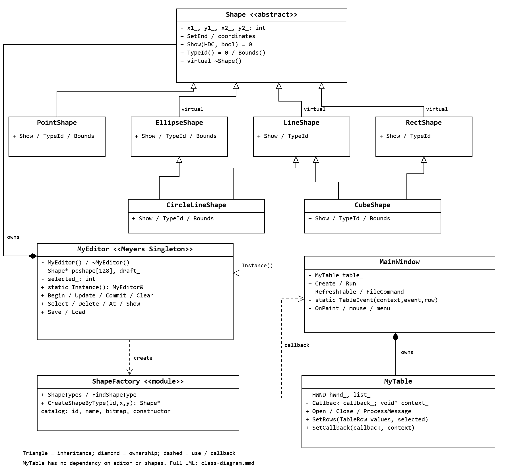
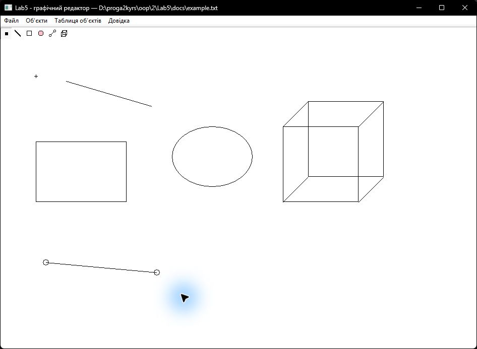
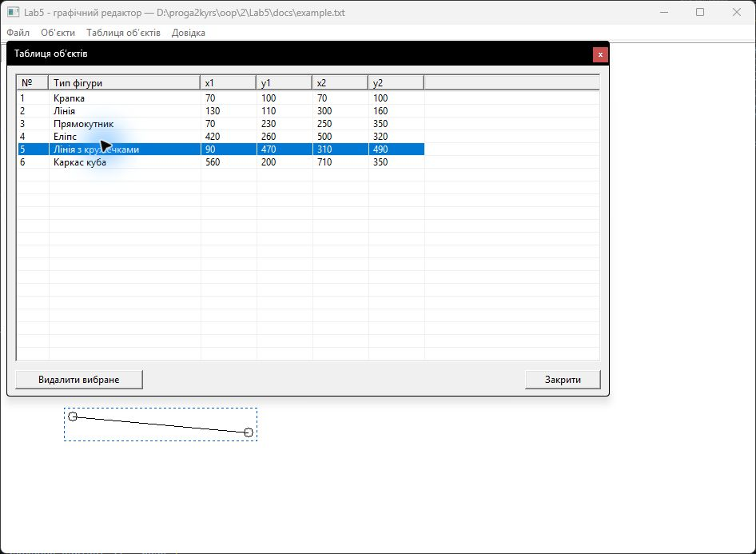
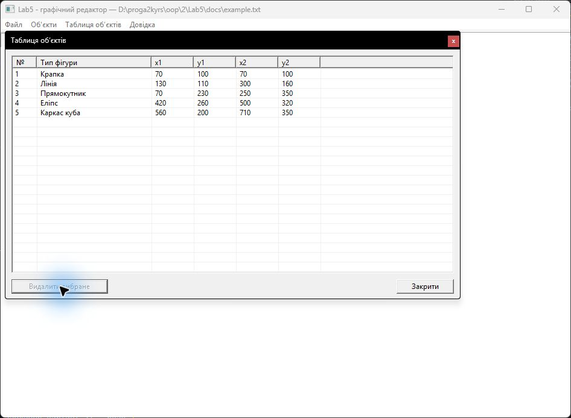

МІНІСТЕРСТВО ОСВІТИ І НАУКИ УКРАЇНИ
НАЦІОНАЛЬНИЙ ТЕХНІЧНИЙ УНІВЕРСИТЕТ УКРАЇНИ
«КИЇВСЬКИЙ ПОЛІТЕХНІЧНИЙ ІНСТИТУТ ІМЕНІ ІГОРЯ СІКОРСЬКОГО»
Факультет інформатики та обчислювальної техніки
Кафедра обчислювальної техніки

ЗВІТ
до лабораторної роботи №5
з дисципліни «Об’єктно-орієнтоване програмування»
Розробка багатовіконного інтерфейсу користувача для графічного редактора об’єктів

Виконав студент групи ІМ-53
Школа Михайло Володимирович
Варіант №27
Перевірив Рекечинський Д. О.

Київ 2026

# 1 Мета роботи

Отримати вміння та навички програмувати багатовіконний інтерфейс в об’єктно-орієнтованому стилі. У роботі редактор Lab4 доповнено немодальною таблицею, збереженням і завантаженням об’єктів, а єдиний MyEditor реалізовано як Singleton Меєрса. Реалізовано всі три бонусні можливості.

# 2 Варіант завдання 27

За методичкою «oop-practicum-simplified (3).pdf», сторінки 17–19, для непарних номерів потрібен Singleton Меєрса. Номер 27 є непарним. Необхідно зберегти кольори та стилі Lab4, додати клас немодальної таблиці в окремому модулі, окремий пункт меню для її відкриття і закриття та запис множини об’єктів у файл. Бонуси: виділення через рядок таблиці, видалення з масиву та завантаження файлу. Для виділення і видалення заборонені нові залежності модуля таблиці від модулів редактора.

# 3 Аналіз основи та реалізація

Проєкт створено копіюванням потрібних джерел і ресурсів Lab4 у Lab5. Збережено Shape, PointShape, LineShape, RectShape, EllipseShape, CircleLineShape, CubeShape, MainWindow, MyEditor та класи захисту GDI. Оригінальну папку Lab4 не змінено. Успадковано масив Shape* pcshape[128], чернетку, обробники миші й WM_PAINT. Лінія з кружечками успадковує LineShape та EllipseShape, куб — LineShape та RectShape; проміжні класи віртуально успадковують Shape, тож складена фігура має одну спільну базу.

## 3.1 Singleton Меєрса

```
MyEditor& MyEditor::Instance() noexcept {
    static MyEditor instance;
    return instance;
}
```

Конструктор і деструктор MyEditor приватні. Копіювання та присвоювання видалені; неявного переміщення також немає. Перший виклик Instance створює локальний static, ініціалізація якого потокобезпечна з C++11. Він автоматично знищується при нормальному завершенні програми. Самі методи редактора викликаються з одного GUI-потоку. Глобального static MyEditor з Lab4 більше немає. Деструктор викликає Clear, який видаляє чернетку і всі фігури.

## 3.2 Немодальна таблиця та callback

MyTable оголошено у MyTable.h та реалізовано у MyTable.cpp. Ресурс IDD_TABLE містить ListView і дві кнопки. Open викликає CreateDialogParamW і ShowWindow. Головне вікно не вимикається. Цикл повідомлень викликає IsDialogMessageW через ProcessMessage, тому працює клавіатурна навігація. Close викликає DestroyWindow, а не EndDialog. Повторний Open активує існуючий діалог. Пункт меню перемикає його стан; WM_CLOSE і вихід із головної програми закривають таблицю.

```
using Callback = void (*)(void* context, Event event, int row);
table_.SetCallback(&MainWindow::TableEvent, this);
```

Таблиця отримує вектор простих TableRow: назву та чотири координати. Вона не включає MyEditor.h, Shape.h або MainWindow.h. Події Select, Delete та Closed передаються через вказівник на функцію і непрозорий контекст void*. MainWindow викликає Select або Delete редактора й оновлює зображення. Під час перебудови рядків прапорець updating_ пригнічує службові повідомлення вибору та запобігає рекурсивним callback.

## 3.3 Виділення та видалення

Вибраний індекс зберігається в MyEditor. Після звичайного малювання Show додає синю пунктирну рамку навколо Bounds вибраної фігури. Її чорний контур і заповнення не змінюються. Похідні класи уточнюють Bounds для крапки, еліпса, кружечків і куба. Delete перевіряє індекс, викликає delete через Shape*, зсуває наступні вказівники, очищує останню комірку та виправляє вибір. Віртуальний деструктор Shape забезпечує коректне видалення нащадка. Після цього MainWindow перебудовує таблицю й інвалідує полотно.

## 3.4 Каталог типів та поліморфізм

ShapeFactory містить каталог ID, назв, ресурсів bitmap і функцій створення. Редактор створює фігури через CreateShapeByType. Меню, Toolbar і підказки використовують той самий каталог. Shape надає віртуальні Show, TypeId і Bounds. Таблиця та цикли малювання і серіалізації не залежать від конкретного нащадка. Для нового типу додаються клас, запис каталогу, ресурс піктограми та джерело в CMake; алгоритми наявних модулів редактора і таблиці переписувати не потрібно.

# 4 Формат файлу та перевірка даних

Текстовий формат має версію та кількість об’єктів. Кожний наступний запис містить ID типу і початкові та кінцеві координати. ID 10–15 позначають відповідно крапку, лінію, прямокутник, еліпс, лінію з кружечками та куб. Для еліпса перша точка — центр, друга задає радіуси, як у Lab4. Для куба це точки введення, з яких обчислюються грані. Тип визначає стиль, тому колір окремо не записується. Приклад містить усі шість типів.

```
LAB5 1 6
10 70 100 70 100
11 130 110 300 160
12 70 230 250 350
13 420 260 500 320
14 90 470 310 490
15 560 200 710 350
```

Save готує весь текст, створює тимчасовий файл у цільовій папці, перевіряє запис, FlushFileBuffers і CloseHandle, після чого замінює ціль через MoveFileExW. При невдалій заміні попередній файл зберігається. Діалог збереження підтверджує перезапис. Load допускає лише версію 1, до 128 об’єктів, файл до 64 КіБ і координати від −1000000 до 1000000. Невідомі типи, неповні записи, переповнення чисел і зайві дані відхиляються. Об’єкти спочатку створюються в тимчасовому векторі unique_ptr; поточний масив замінюється лише після повного успіху. На помилці тимчасові об’єкти автоматично видаляються. Поточні фігури й вибір залишаються без змін.

# 5 UML діаграма класів



Рисунок 1. Успадкування, володіння та взаємодія модулів

Трикутник вказує на базовий клас, ромб позначає володіння, пунктир — використання або передавання callback. Стрілка callback не означає включення MainWindow.h у MyTable. Повна редагована схема Mermaid міститься в docs/class-diagram.mmd.

# 6 Робота програми

Обрати інструмент у меню або на Toolbar, натиснути ліву кнопку на полотні, перетягнути й відпустити. Для крапки достатньо клацання. Пункт «Таблиця об’єктів» відкриває і закриває немодальний діалог. Вибір рядка виділяє відповідну фігуру; кнопка видалення або Delete прибирає її. Меню «Файл» містить відкриття і збереження. Перед завантаженням поверх непорожнього малюнка потрібно підтвердити заміну.



Рисунок 2. Справжній Lab5 після відкриття example.txt з усіма шістьма типами



Рисунок 3. П’ятий рядок таблиці виділяє лінію з кружечками на полотні



Рисунок 4. Після видалення лінії лишилися п’ять рядків і п’ять фігур

# 7 Результати перевірки

18 листопада 2026 року виконано збирання Windows-програми через CMake з GNU C++ 16.2.0 MinGW UCRT64, конфігурація Debug. У фінальному складанні помилок і попереджень не виявлено. Усі три тести CTest пройшли.

```
Lab5ModelSmoke    Passed
Lab5EditorSmoke   Passed
Lab5WindowSmoke   Passed
100% tests passed, 0 tests failed out of 3
```

ModelSmoke перевіряє шість фігур, пікселі повторного малювання, пунктир, відсутність заповнення і відновлення стану GDI. Після 500 циклів малювання кількість GDI-об’єктів не збільшується. EditorSmoke перевіряє властивості Singleton, життєвий цикл чернетки, межу масиву, видалення й файловий round trip шести типів, порожнього набору і 128 фігур, Unicode-шляхи, пошкоджені файли та помилки запису. Зокрема перевірено збереження початкового файлу при заблокованій заміні.

WindowSmoke створює справжнє головне вікно і діалог. Перевірено малювання при відкритій таблиці, оновлення рядків, callback вибору й видалення, повторне відкриття та автоматичне закриття таблиці. 200 перемальовувань із виділенням не збільшили кількість GDI-об’єктів. У видимому GUI перевірено відкриття прикладу, вибір п’ятого рядка, видалення відповідної фігури й вихід. Наведені скріншоти зроблено із запущеної програми. Повний протокол — docs/verification.md.

MSVC не перевірявся через відсутність Visual Studio. Окремий аналізатор купи не використовувався; звільнення пам’яті перевірено за володінням у коді та сценаріями очищення, видалення й невдалого завантаження. Тексти tooltip перевірено автоматично, час появи їх popup не вимірювався.

# 8 Відповіді на контрольні запитання

## 8.1 Що таке патерн проєктування

Патерн проєктування — узагальнений спосіб розв’язання повторюваної задачі проєктування програм. Він описує ролі об’єктів, їхні зв’язки та умови застосування, а не готовий фрагмент програми для будь-якого випадку. У цій роботі Singleton керує єдиним екземпляром редактора, а callback послаблює залежності між вікнами.

## 8.2 Що таке Singleton

Singleton — патерн, який забезпечує єдиний екземпляр класу та точку доступу до нього. У MyEditor створення обмежене приватним конструктором, копіювання заборонене, а Instance повертає посилання на єдиний об’єкт. Singleton доречний тут за вимогою варіанта; він також створює спільний стан, тому в інших задачах його слід застосовувати обдумано.

## 8.3 Чим відрізняється класична реалізація Singleton від Singleton Меєрса

Класична реалізація часто зберігає статичний вказівник, виділяє об’єкт через new і потребує явного рішення щодо видалення та синхронізації створення. Singleton Меєрса використовує локальний static усередині функції Instance. Він створюється при першому зверненні й автоматично знищується при нормальному завершенні. З C++11 його ініціалізація потокобезпечна, але це не робить автоматично потокобезпечними інші методи класу. Для непарного варіанта 27 використано Меєрса.

## 8.4 Як запрограмувати немодальне діалогове вікно

Потрібно описати ресурс DIALOGEX, написати DLGPROC і створити діалог через CreateDialogParamW. У WM_INITDIALOG зберігається this у DWLP_USER та налаштовуються контроли. Діалог показується ShowWindow, а його повідомлення обробляються загальним циклом із IsDialogMessageW. Головне вікно залишається активним. Закриття виконує DestroyWindow; EndDialog призначений для модальних діалогів DialogBox.

## 8.5 Як запрограмувати запис у файл об’єктів геометричних форм

Для кожного об’єкта треба записати стійкий ідентифікатор типу та дані, достатні для відновлення, тут чотири координати. Вказівники й сирий образ пам’яті C++-об’єкта записувати не можна: вони містять адреси та службові дані, які не відновлюють об’єкт. У Save використано TypeId і методи координат, перевірено всі операції запису. Load перевіряє формат, створює потрібного нащадка через фабрику й установлює координати.

## 8.6 Поліморфізм у програмі

Масив Shape* містить об’єкти різних похідних класів. Вираз pcshape[i]->Show(dc) викликає Show фактичної фігури через віртуальну диспетчеризацію. Так само TypeId повертає ID конкретного нащадка, а Bounds визначає його межі. Віртуальний деструктор забезпечує правильне delete через Shape*. Редактор малює та видаляє різні типи через один інтерфейс без перевірок dynamic_cast.

# 9 Висновки

Я розширив редактор Lab4 до багатовіконної програми Lab5. Єдиний MyEditor реалізовано через локальний static за патерном Singleton Меєрса. Немодальна таблиця відображає типи й координати та через callback передає вибір і видалення без залежності від редактора. Реалізовано текстове збереження і завантаження всіх шести типів, перевірку пошкоджених даних і збереження попереднього файлу при невдалій заміні. Збережено успадкування та стилі Lab4. Усі три бонуси виконано, MinGW-збирання й автоматичні перевірки пройшли.

# 10 Вихідні тексти власних модулів

Наведено головний файл і повні тексти модулів програми, ресурсний шаблон та конфігурацію CMake. Піктограми bitmap залишено файлами у resources. Тести та генератор звіту доступні окремо в tests і tools.

## src/main.cpp

```
#include "MainWindow.h"

int WINAPI wWinMain(HINSTANCE instance, HINSTANCE, PWSTR, int showCommand) {
    MainWindow window;
    if (!window.Create(instance, showCommand)) return 1;
    return window.Run();
}
```

## src/Shape.h

```
#pragma once

#include <windows.h>

class Shape {
public:
    Shape(int x, int y) noexcept;
    virtual ~Shape();

    void SetEnd(int x, int y) noexcept;
    int StartX() const noexcept;
    int StartY() const noexcept;
    int EndX() const noexcept;
    int EndY() const noexcept;

    virtual int TypeId() const noexcept = 0;
    virtual RECT Bounds() const noexcept;
    virtual void Show(HDC dc, bool preview = false) const = 0;

private:
    int x1_;
    int y1_;
    int x2_;
    int y2_;
};
```

## src/Shape.cpp

```
#include "Shape.h"

Shape::Shape(int x, int y) noexcept : x1_(x), y1_(y), x2_(x), y2_(y) {}
Shape::~Shape() = default;

void Shape::SetEnd(int x, int y) noexcept { x2_ = x; y2_ = y; }
int Shape::StartX() const noexcept { return x1_; }
int Shape::StartY() const noexcept { return y1_; }
int Shape::EndX() const noexcept { return x2_; }
int Shape::EndY() const noexcept { return y2_; }

#include <algorithm>
RECT Shape::Bounds() const noexcept {
    return {(std::min)(x1_, x2_), (std::min)(y1_, y2_),
        (std::max)(x1_, x2_), (std::max)(y1_, y2_)};
}
```

## src/PointShape.h

```
#pragma once
#include "Shape.h"
class PointShape : public Shape {
public:
    PointShape(int x, int y) : Shape(x,y) {}
    RECT Bounds() const noexcept override;
    int TypeId() const noexcept override { return 10; }
    void Show(HDC dc, bool preview = false) const override;
};
```

## src/PointShape.cpp

```
#include "PointShape.h"
#include "GdiGuards.h"

void PointShape::Show(HDC dc, bool preview) const {
    if (!dc) return;
    ScopedGdiObject pen(CreatePen(preview ? PS_DOT : PS_SOLID, 1, RGB(0, 0, 0)));
    if (!pen.Get()) return;
    ScopedGdiSelection selectedPen(dc, pen.Get());
    if (!selectedPen.IsSelected()) return;
    const int oldMode = SetBkMode(dc, TRANSPARENT);
    MoveToEx(dc, StartX() - 3, StartY(), nullptr);
    LineTo(dc, StartX() + 4, StartY());
    MoveToEx(dc, StartX(), StartY() - 3, nullptr);
    LineTo(dc, StartX(), StartY() + 4);
    SetBkMode(dc, oldMode);
}

RECT PointShape::Bounds() const noexcept {
    return {StartX()-3, StartY()-3, StartX()+4, StartY()+4};
}
```

## src/LineShape.h

```
#pragma once
#include "Shape.h"
class LineShape : virtual public Shape {
public:
    LineShape(int x, int y) : Shape(x,y) {}
    int TypeId() const noexcept override { return 11; }
    void Show(HDC dc, bool preview = false) const override;
protected:
    void Show(HDC dc, int x1, int y1, int x2, int y2, bool preview) const;
};
```

## src/LineShape.cpp

```
#include "LineShape.h"
#include "GdiGuards.h"

void LineShape::Show(HDC dc, bool preview) const {
    Show(dc, StartX(), StartY(), EndX(), EndY(), preview);
}

void LineShape::Show(HDC dc, int x1, int y1, int x2, int y2, bool preview) const {
    if (!dc) return;
    ScopedGdiObject pen(CreatePen(preview ? PS_DOT : PS_SOLID, 1, RGB(0, 0, 0)));
    if (!pen.Get()) return;
    ScopedGdiSelection selectedPen(dc, pen.Get());
    if (!selectedPen.IsSelected()) return;
    const int oldMode = SetBkMode(dc, TRANSPARENT);
    MoveToEx(dc, x1, y1, nullptr);
    LineTo(dc, x2, y2);
    SetBkMode(dc, oldMode);
}
```

## src/RectShape.h

```
#pragma once
#include "Shape.h"
class RectShape : virtual public Shape {
public:
    RectShape(int x, int y) : Shape(x,y) {}
    int TypeId() const noexcept override { return 12; }
    void Show(HDC dc, bool preview = false) const override;
protected:
    void Show(HDC dc, int x1, int y1, int x2, int y2, bool preview) const;
};
```

## src/RectShape.cpp

```
#include "RectShape.h"
#include "GdiGuards.h"
#include <algorithm>

void RectShape::Show(HDC dc, bool preview) const {
    Show(dc, StartX(), StartY(), EndX(), EndY(), preview);
}

void RectShape::Show(HDC dc, int x1, int y1, int x2, int y2, bool preview) const {
    if (!dc) return;
    ScopedGdiObject pen(CreatePen(preview ? PS_DOT : PS_SOLID, 1, RGB(0, 0, 0)));
    if (!pen.Get()) return;
    ScopedGdiSelection selectedPen(dc, pen.Get());
    if (!selectedPen.IsSelected()) return;

    HBRUSH nullBrush = static_cast<HBRUSH>(GetStockObject(NULL_BRUSH));
    if (!nullBrush) return;
    ScopedGdiSelection selectedBrush(dc, nullBrush);
    if (!selectedBrush.IsSelected()) return;

    const int oldMode = SetBkMode(dc, TRANSPARENT);
    const int left = (std::min)(x1, x2);
    const int top = (std::min)(y1, y2);
    const int right = (std::max)(x1, x2);
    const int bottom = (std::max)(y1, y2);
    Rectangle(dc, left, top, right, bottom);
    SetBkMode(dc, oldMode);
}
```

## src/EllipseShape.h

```
#pragma once
#include "Shape.h"
class EllipseShape : virtual public Shape {
public:
    EllipseShape(int x, int y) : Shape(x,y) {}
    RECT Bounds() const noexcept override;
    int TypeId() const noexcept override { return 13; }
    void Show(HDC dc, bool preview = false) const override;
protected:
    void Show(HDC dc, int x1, int y1, int x2, int y2, bool preview) const;
};
```

## src/EllipseShape.cpp

```
#include "EllipseShape.h"
#include "GdiGuards.h"
#include <algorithm>
#include <cstdlib>

void EllipseShape::Show(HDC dc, bool preview) const {
    Show(dc, StartX(), StartY(), EndX(), EndY(), preview);
}

void EllipseShape::Show(HDC dc, int x1, int y1, int x2, int y2, bool preview) const {
    if (!dc) return;
    ScopedGdiObject pen(CreatePen(preview ? PS_DOT : PS_SOLID, 1, RGB(0, 0, 0)));
    if (!pen.Get()) return;
    ScopedGdiSelection selectedPen(dc, pen.Get());
    if (!selectedPen.IsSelected()) return;

    HBRUSH brush = static_cast<HBRUSH>(GetStockObject(NULL_BRUSH));
    if (!brush) return;
    ScopedGdiSelection selectedBrush(dc, brush);
    if (!selectedBrush.IsSelected()) return;

    const int oldMode = SetBkMode(dc, TRANSPARENT);
    const int centerX = x1;
    const int centerY = y1;
    const int radiusX = (std::max)(std::abs(x2 - centerX), 1);
    const int radiusY = (std::max)(std::abs(y2 - centerY), 1);
    const int left = centerX - radiusX;
    const int top = centerY - radiusY;
    const int right = centerX + radiusX;
    const int bottom = centerY + radiusY;
    ::Ellipse(dc, left, top, right, bottom);
    SetBkMode(dc, oldMode);
}

RECT EllipseShape::Bounds() const noexcept {
    int rx = (std::max)(std::abs(EndX()-StartX()), 1);
    int ry = (std::max)(std::abs(EndY()-StartY()), 1);
    return {StartX()-rx, StartY()-ry, StartX()+rx, StartY()+ry};
}
```

## src/CircleLineShape.h

```
#pragma once
#include "LineShape.h"
#include "EllipseShape.h"

class CircleLineShape : public LineShape, public EllipseShape {
public:
    CircleLineShape(int x, int y) : Shape(x, y), LineShape(x, y), EllipseShape(x, y) {}
    RECT Bounds() const noexcept override;
    int TypeId() const noexcept override { return 14; }
    void Show(HDC dc, bool preview = false) const override;
};
```

## src/CircleLineShape.cpp

```
#include "CircleLineShape.h"

void CircleLineShape::Show(HDC dc, bool preview) const {
    const int radius = 6;
    LineShape::Show(dc, preview);
    // Кружечки задаються центром і кутом рамки.
    EllipseShape::Show(dc, StartX(), StartY(), StartX() + radius, StartY() + radius, preview);
    EllipseShape::Show(dc, EndX(), EndY(), EndX() + radius, EndY() + radius, preview);
}

RECT CircleLineShape::Bounds() const noexcept {
    RECT r = Shape::Bounds();
    InflateRect(&r, 6, 6);
    return r;
}
```

## src/CubeShape.h

```
#pragma once
#include "LineShape.h"
#include "RectShape.h"

class CubeShape : public LineShape, public RectShape {
public:
    CubeShape(int x, int y) : Shape(x, y), LineShape(x, y), RectShape(x, y) {}
    RECT Bounds() const noexcept override;
    int TypeId() const noexcept override { return 15; }
    void Show(HDC dc, bool preview = false) const override;
};
```

## src/CubeShape.cpp

```
#include "CubeShape.h"
#include <algorithm>
#include <cstdlib>

void CubeShape::Show(HDC dc, bool preview) const {
    // Передня грань квадратна, задня зміщена вправо та вгору.
    const int side = (std::max)(1, (std::min)(
        std::abs(EndX() - StartX()), std::abs(EndY() - StartY())));
    const int x1 = StartX();
    const int y1 = StartY();
    const int x2 = x1 + (EndX() < x1 ? -side : side);
    const int y2 = y1 + (EndY() < y1 ? -side : side);
    const int offset = (std::max)(1, side / 3);

    RectShape::Show(dc, x1, y1, x2, y2, preview);
    RectShape::Show(dc, x1 + offset, y1 - offset, x2 + offset, y2 - offset, preview);
    LineShape::Show(dc, x1, y1, x1 + offset, y1 - offset, preview);
    LineShape::Show(dc, x2, y1, x2 + offset, y1 - offset, preview);
    LineShape::Show(dc, x1, y2, x1 + offset, y2 - offset, preview);
    LineShape::Show(dc, x2, y2, x2 + offset, y2 - offset, preview);
}

RECT CubeShape::Bounds() const noexcept {
    const int side = (std::max)(1, (std::min)(std::abs(EndX()-StartX()), std::abs(EndY()-StartY())));
    const int x = StartX() + (EndX()<StartX() ? -side : side);
    const int y = StartY() + (EndY()<StartY() ? -side : side);
    const int offset = (std::max)(1, side/3);
    return {(std::min)(StartX(),x), (std::min)(StartY(),y)-offset,
        (std::max)(StartX(),x)+offset, (std::max)(StartY(),y)};
}
```

## src/ShapeFactory.h

```
#pragma once
#include "Shape.h"

// Єдине місце реєстрації типів: редактор і таблиця не знають похідних класів.
struct ShapeType {
    int id;
    const wchar_t* name;
    int bitmapId;
    Shape* (*create)(int, int);
};
const ShapeType* ShapeTypes(int& count) noexcept;
const ShapeType* FindShapeType(int id) noexcept;
Shape* CreateShapeByType(int id, int x, int y) noexcept;
```

## src/ShapeFactory.cpp

```
#include "ShapeFactory.h"
#include "PointShape.h"
#include "LineShape.h"
#include "RectShape.h"
#include "EllipseShape.h"
#include "CircleLineShape.h"
#include "CubeShape.h"
#include "../resources/resource.h"
#include <new>

namespace {
template<class T> Shape* Make(int x, int y) { return new (std::nothrow) T(x, y); }
const ShapeType types[] = {
    {10, L"Крапка", IDB_TOOL_DOT, Make<PointShape>},
    {11, L"Лінія", IDB_TOOL_LINE, Make<LineShape>},
    {12, L"Прямокутник", IDB_TOOL_RECT, Make<RectShape>},
    {13, L"Еліпс", IDB_TOOL_ELLIPSE, Make<EllipseShape>},
    {14, L"Лінія з кружечками", IDB_TOOL_CIRCLE_LINE, Make<CircleLineShape>},
    {15, L"Каркас куба", IDB_TOOL_CUBE, Make<CubeShape>}
};
}
const ShapeType* ShapeTypes(int& count) noexcept {
    count = static_cast<int>(sizeof(types)/sizeof(types[0]));
    return types;
}
const ShapeType* FindShapeType(int id) noexcept {
    for (const auto& type : types) if (type.id == id) return &type;
    return nullptr;
}
Shape* CreateShapeByType(int id, int x, int y) noexcept {
    const auto* type = FindShapeType(id);
    return type ? type->create(x, y) : nullptr;
}
```

## src/MyEditor.h

```
#pragma once

#include "Shape.h"
#include <string>

class MyEditor {
public:
    static constexpr int kCapacity = 128;

    static MyEditor& Instance() noexcept;
    MyEditor(const MyEditor&) = delete;
    MyEditor& operator=(const MyEditor&) = delete;

    bool SetTool(int commandId) noexcept;
    int CurrentTool() const noexcept;
    bool Begin(int x, int y) noexcept;
    void Update(int x, int y) noexcept;
    bool Commit() noexcept;
    bool Cancel() noexcept;
    bool HasDraft() const noexcept;
    int Count() const noexcept;
    void Show(HDC dc) const;
    void Clear() noexcept;
    const Shape* At(int index) const noexcept;
    bool Delete(int index) noexcept;
    void Select(int index) noexcept;
    int Selected() const noexcept { return selected_; }
    bool Save(const std::wstring& path, std::wstring& error) const;
    bool Load(const std::wstring& path, std::wstring& error);

private:
    MyEditor() noexcept = default;
    ~MyEditor();
    Shape* CreateShape(int x, int y) const noexcept;

    Shape* pcshape[kCapacity]{};
    int count_ = 0;
    int toolId_ = 10;
    Shape* draft_ = nullptr;
    int selected_ = -1;
};
```

## src/MyEditor.cpp

```
#include "MyEditor.h"
#include "ShapeFactory.h"
#include "GdiGuards.h"
#include <filesystem>
#include <fstream>
#include <sstream>
#include <memory>
#include <vector>
#include <locale>
#include <new>

MyEditor& MyEditor::Instance() noexcept {
    static MyEditor instance;
    return instance;
}

MyEditor::~MyEditor() { Clear(); }

bool MyEditor::SetTool(int commandId) noexcept {
    if (!FindShapeType(commandId)) return false;
    Cancel();
    toolId_ = commandId;
    return true;
}

int MyEditor::CurrentTool() const noexcept { return toolId_; }

Shape* MyEditor::CreateShape(int x, int y) const noexcept {
    return CreateShapeByType(toolId_, x, y);
}

bool MyEditor::Begin(int x, int y) noexcept {
    if (draft_ || count_ >= kCapacity) return false;
    draft_ = CreateShape(x, y);
    return draft_ != nullptr;
}

void MyEditor::Update(int x, int y) noexcept {
    if (draft_) draft_->SetEnd(x, y);
}

bool MyEditor::Commit() noexcept {
    if (!draft_ || count_ >= kCapacity) return false;
    pcshape[count_++] = draft_;
    draft_ = nullptr;
    return true;
}

bool MyEditor::Cancel() noexcept {
    if (!draft_) return false;
    delete draft_;
    draft_ = nullptr;
    return true;
}

bool MyEditor::HasDraft() const noexcept { return draft_ != nullptr; }
int MyEditor::Count() const noexcept { return count_; }

void MyEditor::Show(HDC dc) const {
    if (!dc) return;
    for (int i = 0; i < count_; ++i) {
        if (pcshape[i]) pcshape[i]->Show(dc);
    }
    if (draft_) draft_->Show(dc, true);
    if (const Shape* shape = At(selected_)) {
        RECT r = shape->Bounds();
        InflateRect(&r, 5, 5);
        ScopedGdiObject pen(CreatePen(PS_DOT, 1, RGB(0, 90, 210)));
        if (!pen.Get()) return;
        ScopedGdiSelection selectedPen(dc, pen.Get());
        ScopedGdiSelection brush(dc, GetStockObject(NULL_BRUSH));
        if (!selectedPen.IsSelected() || !brush.IsSelected()) return;
        const int oldMode = SetBkMode(dc, TRANSPARENT);
        Rectangle(dc, r.left, r.top, r.right, r.bottom);
        SetBkMode(dc, oldMode);
    }
}

void MyEditor::Clear() noexcept {
    Cancel();
    for (int i = 0; i < count_; ++i) {
        delete pcshape[i];
        pcshape[i] = nullptr;
    }
    count_ = 0;
    selected_ = -1;
}

const Shape* MyEditor::At(int index) const noexcept {
    return index >= 0 && index < count_ ? pcshape[index] : nullptr;
}

void MyEditor::Select(int index) noexcept { selected_ = At(index) ? index : -1; }

bool MyEditor::Delete(int index) noexcept {
    if (!At(index)) return false;
    delete pcshape[index];
    for (int i = index; i < count_-1; ++i) pcshape[i] = pcshape[i+1];
    pcshape[--count_] = nullptr;
    if (selected_ == index) selected_ = -1;
    else if (selected_ > index) --selected_;
    return true;
}

bool MyEditor::Save(const std::wstring& path, std::wstring& error) const {
    error.clear();
    try {
        std::ostringstream text;
        text.imbue(std::locale::classic());
        text << "LAB5 1 " << count_ << '\n';
        for (int i = 0; i < count_; ++i) {
            const Shape& s = *pcshape[i];
            text << s.TypeId() << ' ' << s.StartX() << ' ' << s.StartY() << ' '
                << s.EndX() << ' ' << s.EndY() << '\n';
        }
        const std::string data = text.str();
        const auto target = std::filesystem::absolute(path);
        wchar_t temp[MAX_PATH]{};
        // Тимчасовий файл у тій самій папці, щоб заміна була в межах одного тому.
        if (!GetTempFileNameW(target.parent_path().c_str(), L"lb5", 0, temp)) {
            error = L"Не вдалося створити тимчасовий файл у вибраній папці.";
            return false;
        }
        HANDLE file = CreateFileW(temp, GENERIC_WRITE, 0, nullptr, TRUNCATE_EXISTING,
            FILE_ATTRIBUTE_NORMAL, nullptr);
        DWORD written = 0;
        bool ok = file != INVALID_HANDLE_VALUE;
        if (ok) {
            ok = WriteFile(file, data.data(), static_cast<DWORD>(data.size()), &written, nullptr)
                && written == data.size();
            if (ok) ok = FlushFileBuffers(file) != FALSE;
            if (!CloseHandle(file)) ok = false;
        }
        if (ok) ok = MoveFileExW(temp, target.c_str(),
            MOVEFILE_REPLACE_EXISTING | MOVEFILE_WRITE_THROUGH) != FALSE;
        if (!ok) {
            DeleteFileW(temp);
            error = L"Не вдалося записати або замінити файл. Попередній файл збережено.";
        }
        return ok;
    } catch (const std::exception&) {
        error = L"Помилка підготовки даних або шляху до файлу.";
        return false;
    }
}

bool MyEditor::Load(const std::wstring& path, std::wstring& error) {
    error.clear();
    try {
        std::ifstream file(std::filesystem::path(path), std::ios::binary | std::ios::ate);
        if (!file || file.tellg() < 0 || file.tellg() > 65536) {
            error = L"Не вдалося відкрити файл або його розмір перевищує 64 КіБ.";
            return false;
        }
        const auto size = static_cast<std::streamsize>(file.tellg());
        file.seekg(0);
        std::string data(static_cast<size_t>(size), '\0');
        // Читаємо рівно перевірений розмір, відхиляємо зміну файлу під час читання.
        if (!file.read(data.data(), size) || file.peek() != std::char_traits<char>::eof()) {
            error = L"Помилка читання або файл змінився під час читання.";
            return false;
        }
        std::istringstream input(data);
        input.imbue(std::locale::classic());
        std::string magic;
        int version = 0, count = 0;
        if (!(input >> magic >> version >> count) || magic != "LAB5" || version != 1
            || count < 0 || count > kCapacity) {
            error = L"Некоректний заголовок файлу LAB5 або кількість об’єктів.";
            return false;
        }
        std::vector<std::unique_ptr<Shape>> loaded;
        for (int i = 0; i < count; ++i) {
            int type, x1, y1, x2, y2;
            if (!(input >> type >> x1 >> y1 >> x2 >> y2)
                || x1 < -1000000 || x1 > 1000000 || y1 < -1000000 || y1 > 1000000
                || x2 < -1000000 || x2 > 1000000 || y2 < -1000000 || y2 > 1000000) {
                error = L"Пошкоджені координати або неповний опис об’єкта.";
                return false;
            }
            std::unique_ptr<Shape> shape(CreateShapeByType(type, x1, y1));
            if (!shape) { error = L"Невідомий тип фігури або недостатньо пам’яті."; return false; }
            shape->SetEnd(x2, y2);
            loaded.push_back(std::move(shape));
        }
        input >> std::ws;
        if (!input.eof()) { error = L"Зайві дані після останнього об’єкта."; return false; }
        // Лише повністю перевірений набір замінює поточний малюнок.
        Clear();
        for (auto& shape : loaded) pcshape[count_++] = shape.release();
        return true;
    } catch (const std::exception&) {
        error = L"Помилка читання файлу або недостатньо пам’яті.";
        return false;
    }
}
```

## src/MyTable.h

```
#pragma once
#include <windows.h>
#include <string>
#include <vector>

// Таблиця отримує готові значення, не залежить від Shape, MyEditor чи MainWindow.
struct TableRow {
    std::wstring type;
    int x1, y1, x2, y2;
};

class MyTable {
public:
    enum class Event { Select, Delete, Closed };
    using Callback = void (*)(void* context, Event event, int row);
    MyTable() = default;
    ~MyTable() { Close(); }
    MyTable(const MyTable&) = delete;
    MyTable& operator=(const MyTable&) = delete;

    void SetCallback(Callback callback, void* context) noexcept;
    bool Open(HINSTANCE instance, HWND owner);
    void Close();
    bool IsOpen() const noexcept { return hwnd_ != nullptr; }
    bool ProcessMessage(MSG& message) const;
    void SetRows(const std::vector<TableRow>& rows, int selected);

private:
    static INT_PTR CALLBACK DialogProc(HWND hwnd, UINT message, WPARAM wParam, LPARAM lParam);
    INT_PTR Dispatch(UINT message, WPARAM wParam, LPARAM lParam);
    void Notify(Event event, int row);
    void Resize();
    HWND hwnd_ = nullptr;
    HWND list_ = nullptr;
    bool updating_ = false;
    Callback callback_ = nullptr;
    void* context_ = nullptr;
};
```

## src/MyTable.cpp

```
#include "MyTable.h"
#include "../resources/resource.h"
#include <commctrl.h>

void MyTable::SetCallback(Callback callback, void* context) noexcept {
    callback_ = callback;
    context_ = context;
}

bool MyTable::Open(HINSTANCE instance, HWND owner) {
    if (hwnd_) { ShowWindow(hwnd_, SW_SHOW); SetForegroundWindow(hwnd_); return true; }
    INITCOMMONCONTROLSEX controls{sizeof(controls), ICC_LISTVIEW_CLASSES};
    if (!InitCommonControlsEx(&controls)) return false;
    HWND dialog = CreateDialogParamW(instance, MAKEINTRESOURCEW(IDD_TABLE), owner,
        DialogProc, reinterpret_cast<LPARAM>(this));
    if (!dialog) return false;
    ShowWindow(dialog, SW_SHOW);
    return true;
}

void MyTable::Close() { if (hwnd_) DestroyWindow(hwnd_); }
bool MyTable::ProcessMessage(MSG& message) const {
    return hwnd_ && IsDialogMessageW(hwnd_, &message);
}
void MyTable::Notify(Event event, int row) {
    if (callback_) callback_(context_, event, row);
}

void MyTable::SetRows(const std::vector<TableRow>& rows, int selected) {
    if (!list_) return;
    updating_ = true;
    SendMessageW(list_, WM_SETREDRAW, FALSE, 0);
    ListView_DeleteAllItems(list_);
    for (size_t i = 0; i < rows.size(); ++i) {
        std::wstring number = std::to_wstring(i+1);
        LVITEMW item{};
        item.mask = LVIF_TEXT;
        item.iItem = static_cast<int>(i);
        item.pszText = number.data();
        const int row = ListView_InsertItem(list_, &item);
        const auto& r = rows[i];
        std::wstring cells[] = {r.type, std::to_wstring(r.x1), std::to_wstring(r.y1),
            std::to_wstring(r.x2), std::to_wstring(r.y2)};
        for (int col = 0; col < 5; ++col)
            ListView_SetItemText(list_, row, col+1, cells[col].data());
    }
    if (selected >= 0 && selected < static_cast<int>(rows.size())) {
        ListView_SetItemState(list_, selected, LVIS_SELECTED | LVIS_FOCUSED,
            LVIS_SELECTED | LVIS_FOCUSED);
        ListView_EnsureVisible(list_, selected, FALSE);
    }
    EnableWindow(GetDlgItem(hwnd_, IDC_DELETE_SHAPE), selected >= 0);
    SendMessageW(list_, WM_SETREDRAW, TRUE, 0);
    InvalidateRect(list_, nullptr, TRUE);
    updating_ = false;
}

void MyTable::Resize() {
    if (!list_) return;
    RECT r{};
    GetClientRect(hwnd_, &r);
    const int width = (r.right > 280 ? r.right : 280);
    const int height = (r.bottom > 100 ? r.bottom : 100);
    MoveWindow(list_, 10, 10, width-20, height-52, TRUE);
    MoveWindow(GetDlgItem(hwnd_, IDC_DELETE_SHAPE), 10, height-32, 160, 24, TRUE);
    MoveWindow(GetDlgItem(hwnd_, IDCANCEL), width-105, height-32, 95, 24, TRUE);
}

INT_PTR CALLBACK MyTable::DialogProc(HWND hwnd, UINT message, WPARAM wParam, LPARAM lParam) {
    auto* self = reinterpret_cast<MyTable*>(GetWindowLongPtrW(hwnd, DWLP_USER));
    if (message == WM_INITDIALOG) {
        self = reinterpret_cast<MyTable*>(lParam);
        self->hwnd_ = hwnd;
        SetWindowLongPtrW(hwnd, DWLP_USER, reinterpret_cast<LONG_PTR>(self));
    }
    return self ? self->Dispatch(message, wParam, lParam) : FALSE;
}

INT_PTR MyTable::Dispatch(UINT message, WPARAM wParam, LPARAM lParam) {
    switch (message) {
    case WM_INITDIALOG: {
        list_ = GetDlgItem(hwnd_, IDC_SHAPES);
        SendMessageW(list_, CCM_SETUNICODEFORMAT, TRUE, 0);
        ListView_SetExtendedListViewStyle(list_, LVS_EX_FULLROWSELECT | LVS_EX_GRIDLINES | LVS_EX_DOUBLEBUFFER);
        const wchar_t* names[] = {L"№", L"Тип фігури", L"x1", L"y1", L"x2", L"y2"};
        const int widths[] = {40, 190, 70, 70, 70, 70};
        for (int i = 0; i < 6; ++i) {
            LVCOLUMNW column{};
            column.mask = LVCF_TEXT | LVCF_WIDTH;
            column.pszText = const_cast<wchar_t*>(names[i]);
            column.cx = widths[i];
            ListView_InsertColumn(list_, i, &column);
        }
        EnableWindow(GetDlgItem(hwnd_, IDC_DELETE_SHAPE), FALSE);
        Resize();
        return TRUE;
    }
    case WM_GETMINMAXINFO: {
        auto* info = reinterpret_cast<MINMAXINFO*>(lParam);
        info->ptMinTrackSize = {400, 180};
        return TRUE;
    }
    case WM_SIZE: Resize(); return TRUE;
    case WM_COMMAND:
        if (LOWORD(wParam) == IDCANCEL) { Close(); return TRUE; }
        if (LOWORD(wParam) == IDC_DELETE_SHAPE) {
            int row = ListView_GetNextItem(list_, -1, LVNI_SELECTED);
            if (row >= 0) Notify(Event::Delete, row);
            return TRUE;
        }
        break;
    case WM_NOTIFY: {
        const auto* header = reinterpret_cast<NMHDR*>(lParam);
        if (!header || header->hwndFrom != list_ || updating_) break;
        if (header->code == LVN_ITEMCHANGED) {
            const auto* change = reinterpret_cast<NMLISTVIEW*>(lParam);
            if ((change->uChanged & LVIF_STATE)
                && ((change->uOldState ^ change->uNewState) & LVIS_SELECTED)) {
                const int row = ListView_GetNextItem(list_, -1, LVNI_SELECTED);
                EnableWindow(GetDlgItem(hwnd_, IDC_DELETE_SHAPE), row >= 0);
                Notify(Event::Select, row);
            }
        } else if (header->code == LVN_KEYDOWN) {
            const auto* key = reinterpret_cast<NMLVKEYDOWN*>(lParam);
            const int row = ListView_GetNextItem(list_, -1, LVNI_SELECTED);
            if (key->wVKey == VK_DELETE && row >= 0) Notify(Event::Delete, row);
        }
        return TRUE;
    }
    case WM_CLOSE: Close(); return TRUE;
    case WM_NCDESTROY:
        SetWindowLongPtrW(hwnd_, DWLP_USER, 0);
        hwnd_ = nullptr;
        list_ = nullptr;
        Notify(Event::Closed, -1);
        return FALSE;
    }
    return FALSE;
}
```

## src/MainWindow.h

```
#pragma once

#include <windows.h>
#include <commctrl.h>
#include "MyEditor.h"
#include "MyTable.h"

class MainWindow {
public:
    MainWindow() noexcept = default;
    MainWindow(const MainWindow&) = delete;
    MainWindow& operator=(const MainWindow&) = delete;

    bool Create(HINSTANCE instance, int showCommand);
    int Run();

private:
    static LRESULT CALLBACK WndProc(HWND hwnd, UINT message, WPARAM wParam, LPARAM lParam);
    LRESULT Dispatch(UINT message, WPARAM wParam, LPARAM lParam);

    LRESULT OnCreate();
    LRESULT OnPaint();
    LRESULT OnSize(UINT state, int width, int height);
    LRESULT OnLButtonDown(int x, int y);
    LRESULT OnMouseMove(WPARAM keyFlags, int x, int y);
    LRESULT OnLButtonUp(int x, int y);
    LRESULT OnCommand(int commandId);
    LRESULT OnNotify(NMHDR* notification, bool& handled);
    LRESULT OnInitMenuPopup(HMENU menu, UINT position, BOOL isWindowMenu);
    LRESULT OnCancelMode();
    LRESULT OnCaptureChanged(HWND newCapture);
    LRESULT OnDestroy();

    bool CreateToolbar();
    void UpdateToolChecks(int commandId);
    void CancelInput();
    HMENU CreateMenuBar() const;

    static void TableEvent(void* context, MyTable::Event event, int row);
    void RefreshTable();
    void FileCommand(bool save);
    MyTable table_;
    HWND hwnd_ = nullptr;
    HWND toolbar_ = nullptr;
    HWND tooltip_ = nullptr;
    HIMAGELIST imageList_ = nullptr;
    int toolbarHeight_ = 0;
    HINSTANCE instance_ = nullptr;
};
```

## src/MainWindow.cpp

```
#include "MainWindow.h"
#include "../resources/resource.h"
#include <windowsx.h>
#include <commdlg.h>
#include <vector>
#include "ShapeFactory.h"
namespace {
constexpr wchar_t kWindowClassName[] = L"Lab5ShapeEditor";
constexpr int kFirstToolId = 10;
constexpr wchar_t kWindowTitle[] = L"Lab5 - \u0433\u0440\u0430\u0444\u0456\u0447\u043d\u0438\u0439 \u0440\u0435\u0434\u0430\u043a\u0442\u043e\u0440";
}

bool MainWindow::Create(HINSTANCE instance, int showCommand) {
    instance_ = instance;
    WNDCLASSW windowClass{};
    windowClass.lpfnWndProc = &MainWindow::WndProc;
    windowClass.hInstance = instance_;
    windowClass.lpszClassName = kWindowClassName;
    windowClass.hCursor = LoadCursorW(nullptr, IDC_ARROW);
    windowClass.hbrBackground = static_cast<HBRUSH>(GetStockObject(WHITE_BRUSH));
    if (!RegisterClassW(&windowClass) && GetLastError() != ERROR_CLASS_ALREADY_EXISTS) return false;

    HMENU menu = CreateMenuBar();
    if (!menu) return false;
    hwnd_ = CreateWindowW(kWindowClassName, kWindowTitle, WS_OVERLAPPEDWINDOW,
        CW_USEDEFAULT, CW_USEDEFAULT, 960, 700, nullptr, menu, instance_, this);
    if (!hwnd_) {
        DestroyMenu(menu);
        return false;
    }
    ShowWindow(hwnd_, showCommand);
    UpdateWindow(hwnd_);
    return true;
}

int MainWindow::Run() {
    MSG message{};
    int result;
    while ((result = GetMessageW(&message, nullptr, 0, 0)) > 0) {
        if (table_.ProcessMessage(message)) continue;
        TranslateMessage(&message);
        DispatchMessageW(&message);
    }
    return result == -1 ? 1 : static_cast<int>(message.wParam);
}

HMENU MainWindow::CreateMenuBar() const {
    HMENU menu = CreateMenu();
    HMENU file = CreatePopupMenu();
    HMENU objects = CreatePopupMenu();
    HMENU help = CreatePopupMenu();
    if (!menu || !file || !objects || !help) {
        if (menu) DestroyMenu(menu);
        if (file) DestroyMenu(file);
        if (objects) DestroyMenu(objects);
        if (help) DestroyMenu(help);
        return nullptr;
    }
    if (!AppendMenuW(file, MF_STRING, IDM_OPEN, L"Відкрити...")) goto fail;
    if (!AppendMenuW(file, MF_STRING, IDM_SAVE, L"Зберегти...")) goto fail;
    if (!AppendMenuW(file, MF_SEPARATOR, 0, nullptr)) goto fail;
    if (!AppendMenuW(file, MF_STRING, 1, L"\u0412\u0438\u0445\u0456\u0434")) goto fail;
    {
        int count = 0;
        const auto* types = ShapeTypes(count);
        for (int i = 0; i < count; ++i)
            if (!AppendMenuW(objects, MF_STRING, types[i].id, types[i].name)) goto fail;
    }
    if (!AppendMenuW(help, MF_STRING, 2, L"\u041f\u0440\u043e \u043f\u0440\u043e\u0433\u0440\u0430\u043c\u0443")) goto fail;
    if (!AppendMenuW(menu, MF_POPUP, reinterpret_cast<UINT_PTR>(file), L"\u0424\u0430\u0439\u043b")) goto fail;
    file = nullptr;
    if (!AppendMenuW(menu, MF_POPUP, reinterpret_cast<UINT_PTR>(objects), L"\u041e\u0431\u0027\u0454\u043a\u0442\u0438")) goto fail;
    objects = nullptr;
    if (!AppendMenuW(menu, MF_STRING, IDM_TABLE, L"Таблиця об’єктів")) goto fail;
    if (!AppendMenuW(menu, MF_POPUP, reinterpret_cast<UINT_PTR>(help), L"\u0414\u043e\u0432\u0456\u0434\u043a\u0430")) goto fail;
    help = nullptr;
    return menu;

fail:
    if (menu) DestroyMenu(menu);
    if (file) DestroyMenu(file);
    if (objects) DestroyMenu(objects);
    if (help) DestroyMenu(help);
    return nullptr;
}

bool MainWindow::CreateToolbar() {
    int typeCount = 0;
    const auto* types = ShapeTypes(typeCount);
    INITCOMMONCONTROLSEX controls{sizeof(controls), ICC_BAR_CLASSES};
    if (!InitCommonControlsEx(&controls)) return false;
    toolbar_ = CreateWindowExW(0, TOOLBARCLASSNAMEW, nullptr,
        WS_CHILD | WS_VISIBLE | TBSTYLE_FLAT | TBSTYLE_TOOLTIPS | CCS_TOP | CCS_NOPARENTALIGN,
        0, 0, 0, 0, hwnd_, nullptr, instance_, nullptr);
    if (!toolbar_) return false;

    SendMessageW(toolbar_, CCM_SETUNICODEFORMAT, TRUE, 0);
    SendMessageW(toolbar_, TB_BUTTONSTRUCTSIZE, sizeof(TBBUTTON), 0);
    imageList_ = ImageList_Create(16, 16, ILC_COLOR24 | ILC_MASK, typeCount, 0);
    if (!imageList_) return false;

    for (int i = 0; i < typeCount; ++i) {
        int id = types[i].bitmapId;
        HBITMAP bitmap = static_cast<HBITMAP>(LoadImageW(instance_, MAKEINTRESOURCEW(id), IMAGE_BITMAP,
            16, 16, LR_CREATEDIBSECTION));
        if (!bitmap) return false;
        const int imageIndex = ImageList_AddMasked(imageList_, bitmap, RGB(255, 255, 255));
        DeleteObject(bitmap);
        if (imageIndex < 0) return false;
    }
    SendMessageW(toolbar_, TB_SETIMAGELIST, 0, reinterpret_cast<LPARAM>(imageList_));
    SendMessageW(toolbar_, TB_SETBUTTONSIZE, 0, MAKELPARAM(24, 24));

    std::vector<TBBUTTON> buttons(typeCount);
    for (int i = 0; i < typeCount; ++i) {
        buttons[i].iBitmap = i;
        buttons[i].idCommand = types[i].id;
        buttons[i].fsState = TBSTATE_ENABLED;
        buttons[i].fsStyle = BTNS_CHECKGROUP | BTNS_AUTOSIZE;
        buttons[i].iString = -1;
    }
    if (!SendMessageW(toolbar_, TB_ADDBUTTONS, typeCount, reinterpret_cast<LPARAM>(buttons.data()))) return false;
    SendMessageW(toolbar_, TB_AUTOSIZE, 0, 0);
    tooltip_ = reinterpret_cast<HWND>(SendMessageW(toolbar_, TB_GETTOOLTIPS, 0, 0));
    UpdateToolChecks(MyEditor::Instance().CurrentTool());
    return tooltip_ != nullptr;
}

LRESULT CALLBACK MainWindow::WndProc(HWND hwnd, UINT message, WPARAM wParam, LPARAM lParam) {
    MainWindow* self = reinterpret_cast<MainWindow*>(GetWindowLongPtrW(hwnd, GWLP_USERDATA));
    if (message == WM_NCCREATE) {
        const auto* create = reinterpret_cast<const CREATESTRUCTW*>(lParam);
        self = static_cast<MainWindow*>(create->lpCreateParams);
        if (!self) return FALSE;
        self->hwnd_ = hwnd;
        SetWindowLongPtrW(hwnd, GWLP_USERDATA, reinterpret_cast<LONG_PTR>(self));
    }
    if (!self) return DefWindowProcW(hwnd, message, wParam, lParam);
    const LRESULT result = self->Dispatch(message, wParam, lParam);
    if (message == WM_NCDESTROY) {
        SetWindowLongPtrW(hwnd, GWLP_USERDATA, 0);
        self->hwnd_ = nullptr;
    }
    return result;
}

LRESULT MainWindow::Dispatch(UINT message, WPARAM wParam, LPARAM lParam) {
    switch (message) {
    case WM_CREATE: return OnCreate();
    case WM_PAINT: return OnPaint();
    case WM_SIZE: return OnSize(static_cast<UINT>(wParam), LOWORD(lParam), HIWORD(lParam));
    case WM_LBUTTONDOWN: return OnLButtonDown(GET_X_LPARAM(lParam), GET_Y_LPARAM(lParam));
    case WM_MOUSEMOVE: return OnMouseMove(wParam, GET_X_LPARAM(lParam), GET_Y_LPARAM(lParam));
    case WM_LBUTTONUP: return OnLButtonUp(GET_X_LPARAM(lParam), GET_Y_LPARAM(lParam));
    case WM_COMMAND: return OnCommand(LOWORD(wParam));
    case WM_NOTIFY: {
        bool handled = false;
        const LRESULT result = OnNotify(reinterpret_cast<NMHDR*>(lParam), handled);
        return handled ? result : DefWindowProcW(hwnd_, message, wParam, lParam);
    }
    case WM_INITMENUPOPUP:
        return OnInitMenuPopup(reinterpret_cast<HMENU>(wParam), LOWORD(lParam), HIWORD(lParam) != 0);
    case WM_CANCELMODE: return OnCancelMode();
    case WM_CAPTURECHANGED: return OnCaptureChanged(reinterpret_cast<HWND>(lParam));
    case WM_DESTROY: return OnDestroy();
    default: return DefWindowProcW(hwnd_, message, wParam, lParam);
    }
}

LRESULT MainWindow::OnCreate() {
    table_.SetCallback(&MainWindow::TableEvent, this);
    MyEditor::Instance().SetTool(kFirstToolId);
    UpdateToolChecks(kFirstToolId);
    if (CreateToolbar()) return 0;
    if (toolbar_) {
        SendMessageW(toolbar_, TB_SETIMAGELIST, 0, 0);
        DestroyWindow(toolbar_);
        toolbar_ = nullptr;
    }
    if (imageList_) {
        ImageList_Destroy(imageList_);
        imageList_ = nullptr;
    }
    return -1;
}

LRESULT MainWindow::OnPaint() {
    PAINTSTRUCT paint{};
    HDC dc = BeginPaint(hwnd_, &paint);
    if (dc) {
        const int saved = SaveDC(dc);
        RECT client{};
        GetClientRect(hwnd_, &client);
        client.top = toolbarHeight_;
        IntersectClipRect(dc, client.left, client.top, client.right, client.bottom);
        MyEditor::Instance().Show(dc);
        if (saved) RestoreDC(dc, saved);
    }
    EndPaint(hwnd_, &paint);
    return 0;
}

LRESULT MainWindow::OnSize(UINT, int width, int) {
    if (toolbar_) {
        SendMessageW(toolbar_, TB_AUTOSIZE, 0, 0);
        RECT toolbarRect{};
        GetWindowRect(toolbar_, &toolbarRect);
        MapWindowPoints(nullptr, hwnd_, reinterpret_cast<POINT*>(&toolbarRect), 2);
        toolbarHeight_ = toolbarRect.bottom - toolbarRect.top;
        SetWindowPos(toolbar_, nullptr, 0, 0, width, toolbarHeight_,
            SWP_NOZORDER | SWP_NOACTIVATE);
    }
    InvalidateRect(hwnd_, nullptr, TRUE);
    return 0;
}

LRESULT MainWindow::OnLButtonDown(int x, int y) {
    if (y < toolbarHeight_) return 0;
    if (!MyEditor::Instance().Begin(x, y)) {
        const wchar_t* text = MyEditor::Instance().Count() >= MyEditor::kCapacity
            ? L"\u0414\u043e\u0441\u044f\u0433\u043d\u0443\u0442\u043e \u043c\u0435\u0436\u0456 128 \u043e\u0431\u0027\u0454\u043a\u0442\u0456\u0432."
            : L"\u041d\u0435 \u0432\u0434\u0430\u043b\u043e\u0441\u044f \u0441\u0442\u0432\u043e\u0440\u0438\u0442\u0438 \u0444\u0456\u0433\u0443\u0440\u0443.";
        MessageBoxW(hwnd_, text, L"\u0420\u0435\u0434\u0430\u043a\u0442\u043e\u0440 \u0444\u0456\u0433\u0443\u0440", MB_OK | MB_ICONINFORMATION);
        return 0;
    }
    SetCapture(hwnd_);
    InvalidateRect(hwnd_, nullptr, TRUE);
    return 0;
}

LRESULT MainWindow::OnMouseMove(WPARAM, int x, int y) {
    if (MyEditor::Instance().HasDraft()) {
        MyEditor::Instance().Update(x, y);
        InvalidateRect(hwnd_, nullptr, TRUE);
    }
    return 0;
}

LRESULT MainWindow::OnLButtonUp(int x, int y) {
    if (MyEditor::Instance().HasDraft()) {
        MyEditor::Instance().Update(x, y);
        MyEditor::Instance().Commit();
        RefreshTable();
        if (GetCapture() == hwnd_) ReleaseCapture();
        InvalidateRect(hwnd_, nullptr, TRUE);
    }
    return 0;
}

LRESULT MainWindow::OnCommand(int commandId) {
    if (FindShapeType(commandId)) {
        CancelInput();
        if (MyEditor::Instance().SetTool(commandId)) {
            UpdateToolChecks(commandId);
            SetWindowTextW(hwnd_, kWindowTitle);
        }
    } else if (commandId == IDM_TABLE) {
        if (table_.IsOpen()) table_.Close();
        else if (table_.Open(instance_, hwnd_)) RefreshTable();
        else MessageBoxW(hwnd_, L"Не вдалося відкрити таблицю.", L"Помилка", MB_OK | MB_ICONERROR);
        CheckMenuItem(GetMenu(hwnd_), IDM_TABLE,
            MF_BYCOMMAND | (table_.IsOpen() ? MF_CHECKED : MF_UNCHECKED));
    } else if (commandId == IDM_SAVE || commandId == IDM_OPEN) {
        CancelInput();
        FileCommand(commandId == IDM_SAVE);
    } else if (commandId == 1) {
        DestroyWindow(hwnd_);
    } else if (commandId == 2) {
        MessageBoxW(hwnd_, L"\u0413\u0440\u0430\u0444\u0456\u0447\u043d\u0438\u0439 \u0440\u0435\u0434\u0430\u043a\u0442\u043e\u0440. \u0412\u0430\u0440\u0456\u0430\u043d\u0442 27.",
            L"\u041b\u0430\u0431\u043e\u0440\u0430\u0442\u043e\u0440\u043d\u0430 \u0440\u043e\u0431\u043e\u0442\u0430 5", MB_OK | MB_ICONINFORMATION);
    }
    return 0;
}

LRESULT MainWindow::OnNotify(NMHDR* notification, bool& handled) {
    handled = false;
    if (!notification || notification->hwndFrom != tooltip_ || notification->code != TTN_GETDISPINFOW) return 0;

    auto* info = reinterpret_cast<NMTTDISPINFOW*>(notification);
    const UINT commandId = static_cast<UINT>(notification->idFrom);
    const auto* type = FindShapeType(commandId);
    if (!type) return 0;
    info->lpszText = const_cast<wchar_t*>(type->name);
    info->uFlags |= TTF_DI_SETITEM;
    handled = true;
    return 0;
}

LRESULT MainWindow::OnInitMenuPopup(HMENU menu, UINT, BOOL isWindowMenu) {
    if (!isWindowMenu && menu && GetMenuState(menu, static_cast<UINT>(MyEditor::Instance().CurrentTool()), MF_BYCOMMAND) != static_cast<UINT>(-1)) {
        UpdateToolChecks(MyEditor::Instance().CurrentTool());
    }
    return 0;
}

LRESULT MainWindow::OnCancelMode() {
    CancelInput();
    return 0;
}

LRESULT MainWindow::OnCaptureChanged(HWND) {
    if (MyEditor::Instance().Cancel()) InvalidateRect(hwnd_, nullptr, TRUE);
    return 0;
}

void MainWindow::CancelInput() {
    MyEditor::Instance().Cancel();
    if (GetCapture() == hwnd_) ReleaseCapture();
    InvalidateRect(hwnd_, nullptr, TRUE);
}

void MainWindow::UpdateToolChecks(int commandId) {
    int count = 0;
    const auto* types = ShapeTypes(count);
    HMENU menu = GetSubMenu(GetMenu(hwnd_), 1);
    for (int i = 0; i < count; ++i) {
        int id = types[i].id;
        if (toolbar_) SendMessageW(toolbar_, TB_CHECKBUTTON, id, MAKELONG(id == commandId, 0));
        if (menu) CheckMenuItem(menu, id, MF_BYCOMMAND | (id == commandId ? MF_CHECKED : MF_UNCHECKED));
    }
}

LRESULT MainWindow::OnDestroy() {
    table_.Close();
    table_.SetCallback(nullptr, nullptr);
    MyEditor::Instance().Clear();
    if (toolbar_ && imageList_) SendMessageW(toolbar_, TB_SETIMAGELIST, 0, 0);
    if (imageList_) {
        ImageList_Destroy(imageList_);
        imageList_ = nullptr;
    }
    toolbar_ = nullptr;
    tooltip_ = nullptr;
    PostQuitMessage(0);
    return 0;
}

void MainWindow::RefreshTable() {
    if (!table_.IsOpen()) return;
    const auto& editor = MyEditor::Instance();
    std::vector<TableRow> rows;
    for (int i = 0; i < editor.Count(); ++i) {
        const Shape& shape = *editor.At(i);
        const auto* type = FindShapeType(shape.TypeId());
        rows.push_back({type ? type->name : L"Невідомий", shape.StartX(), shape.StartY(), shape.EndX(), shape.EndY()});
    }
    table_.SetRows(rows, editor.Selected());
}

void MainWindow::TableEvent(void* context, MyTable::Event event, int row) {
    auto& self = *static_cast<MainWindow*>(context);
    auto& editor = MyEditor::Instance();
    if (event == MyTable::Event::Select) editor.Select(row);
    else if (event == MyTable::Event::Delete) {
        self.CancelInput();
        editor.Delete(row);
        self.RefreshTable();
    } else {
        editor.Select(-1);
        CheckMenuItem(GetMenu(self.hwnd_), IDM_TABLE, MF_BYCOMMAND | MF_UNCHECKED);
    }
    InvalidateRect(self.hwnd_, nullptr, TRUE);
}

void MainWindow::FileCommand(bool save) {
    wchar_t path[MAX_PATH]{};
    OPENFILENAMEW dialog{};
    dialog.lStructSize = sizeof(dialog);
    dialog.hwndOwner = hwnd_;
    dialog.lpstrFilter = L"Фігури Lab5 (*.txt)\0*.txt\0Усі файли (*.*)\0*.*\0\0";
    dialog.lpstrFile = path;
    dialog.nMaxFile = MAX_PATH;
    dialog.lpstrDefExt = L"txt";
    dialog.Flags = OFN_EXPLORER | OFN_PATHMUSTEXIST | OFN_NOCHANGEDIR
        | (save ? OFN_OVERWRITEPROMPT : OFN_FILEMUSTEXIST);
    const BOOL chosen = save ? GetSaveFileNameW(&dialog) : GetOpenFileNameW(&dialog);
    if (!chosen) {
        if (CommDlgExtendedError()) MessageBoxW(hwnd_, L"Помилка діалогу вибору файлу.", L"Помилка", MB_OK | MB_ICONERROR);
        return;
    }
    if (!save && MyEditor::Instance().Count() > 0
        && MessageBoxW(hwnd_, L"Замінити поточний малюнок даними з файлу?", L"Відкрити файл",
            MB_YESNO | MB_ICONQUESTION | MB_DEFBUTTON2) != IDYES) return;
    std::wstring error;
    const bool ok = save ? MyEditor::Instance().Save(path, error) : MyEditor::Instance().Load(path, error);
    if (!ok) MessageBoxW(hwnd_, error.c_str(), L"Помилка файлу", MB_OK | MB_ICONERROR);
    else {
        if (!save) RefreshTable();
        InvalidateRect(hwnd_, nullptr, TRUE);
        SetWindowTextW(hwnd_, (std::wstring(kWindowTitle) + L" — " + path).c_str());
    }
}
```

## src/GdiGuards.h

```
#pragma once
#include <windows.h>

class ScopedGdiSelection {
public:
    ScopedGdiSelection(HDC dc, HGDIOBJ object) noexcept : dc_(dc), old_(nullptr) {
        if (dc_ && object) {
            old_ = SelectObject(dc_, object);
            if (old_ == HGDI_ERROR) old_ = nullptr;
        }
    }
    ~ScopedGdiSelection() { if (old_) SelectObject(dc_, old_); }
    ScopedGdiSelection(const ScopedGdiSelection&) = delete;
    ScopedGdiSelection& operator=(const ScopedGdiSelection&) = delete;
    bool IsSelected() const noexcept { return old_ != nullptr; }
private:
    HDC dc_;
    HGDIOBJ old_;
};

class ScopedGdiObject {
public:
    explicit ScopedGdiObject(HGDIOBJ object = nullptr) noexcept : object_(object) {}
    ~ScopedGdiObject() { if (object_) DeleteObject(object_); }
    ScopedGdiObject(const ScopedGdiObject&) = delete;
    ScopedGdiObject& operator=(const ScopedGdiObject&) = delete;
    HGDIOBJ Get() const noexcept { return object_; }
private:
    HGDIOBJ object_;
};
```

## resources/resource.h

```
#pragma once
#define IDB_TOOL_DOT 201
#define IDB_TOOL_LINE 202
#define IDB_TOOL_RECT 203
#define IDB_TOOL_ELLIPSE 204
#define IDB_TOOL_CIRCLE_LINE 205
#define IDB_TOOL_CUBE 206
#define IDD_TABLE 300
#define IDC_SHAPES 301
#define IDC_DELETE_SHAPE 302
#define IDM_OPEN 3
#define IDM_SAVE 4
#define IDM_TABLE 5
```

## resources/Lab5.rc.in

```
#include "resource.h"
#include <windows.h>
#include <commctrl.h>
#pragma code_page(65001)

IDD_TABLE DIALOGEX 0, 0, 430, 220
STYLE DS_SETFONT | WS_POPUP | WS_CAPTION | WS_SYSMENU | WS_THICKFRAME
EXSTYLE WS_EX_TOOLWINDOW
CAPTION "Таблиця об’єктів"
FONT 9, "Segoe UI"
BEGIN
    CONTROL "", IDC_SHAPES, "SysListView32", WS_CHILD | WS_VISIBLE | WS_TABSTOP | WS_BORDER | LVS_REPORT | LVS_SINGLESEL | LVS_SHOWSELALWAYS, 7, 7, 416, 182
    PUSHBUTTON "Видалити вибране", IDC_DELETE_SHAPE, 7, 196, 100, 17, WS_TABSTOP
    PUSHBUTTON "Закрити", IDCANCEL, 353, 196, 70, 17, WS_TABSTOP
END
IDB_TOOL_DOT BITMAP "@CMAKE_CURRENT_SOURCE_DIR@/resources/dot.bmp"
IDB_TOOL_LINE BITMAP "@CMAKE_CURRENT_SOURCE_DIR@/resources/line.bmp"
IDB_TOOL_RECT BITMAP "@CMAKE_CURRENT_SOURCE_DIR@/resources/rectangle.bmp"
IDB_TOOL_ELLIPSE BITMAP "@CMAKE_CURRENT_SOURCE_DIR@/resources/ellipse.bmp"
IDB_TOOL_CIRCLE_LINE BITMAP "@CMAKE_CURRENT_SOURCE_DIR@/resources/circle-line.bmp"
IDB_TOOL_CUBE BITMAP "@CMAKE_CURRENT_SOURCE_DIR@/resources/cube.bmp"
```

## CMakeLists.txt

```
cmake_minimum_required(VERSION 3.20)
project(Lab5 LANGUAGES CXX)

if(NOT WIN32)
    message(FATAL_ERROR "Lab5 requires Windows and the WinAPI/GDI")
endif()
enable_language(RC)

configure_file(resources/Lab5.rc.in "${CMAKE_CURRENT_BINARY_DIR}/Lab5Resources.rc" @ONLY)

set(LAB5_MODEL_SOURCES
    src/Shape.cpp
    src/PointShape.cpp
    src/LineShape.cpp
    src/RectShape.cpp
    src/EllipseShape.cpp
    src/CircleLineShape.cpp
    src/ShapeFactory.cpp
    src/CubeShape.cpp
)
set(LAB5_APP_SOURCES
    ${LAB5_MODEL_SOURCES}
    src/MyEditor.cpp
    src/MyTable.cpp
    src/MainWindow.cpp
)

add_executable(Lab5 WIN32
    src/main.cpp
    ${LAB5_APP_SOURCES}
    "${CMAKE_CURRENT_BINARY_DIR}/Lab5Resources.rc"
)
target_include_directories(Lab5 PRIVATE resources)
target_compile_features(Lab5 PRIVATE cxx_std_17)
target_compile_definitions(Lab5 PRIVATE UNICODE _UNICODE NOMINMAX WIN32_LEAN_AND_MEAN)
target_link_libraries(Lab5 PRIVATE user32 gdi32 comctl32 comdlg32)

if(MSVC)
    target_compile_options(Lab5 PRIVATE /W4 /utf-8)
else()
    target_compile_options(Lab5 PRIVATE -Wall -Wextra -Wpedantic)
    target_link_options(Lab5 PRIVATE -municode -static -static-libgcc -static-libstdc++)
endif()

option(LAB5_BUILD_TESTS "Build model and editor smoke tests" OFF)
if(LAB5_BUILD_TESTS)
    enable_testing()
    add_executable(Lab5ModelSmoke tests/model_smoke.cpp ${LAB5_MODEL_SOURCES})
    add_executable(Lab5EditorSmoke tests/editor_smoke.cpp src/MyEditor.cpp ${LAB5_MODEL_SOURCES})
    add_executable(Lab5WindowSmoke tests/window_smoke.cpp ${LAB5_APP_SOURCES}
        "${CMAKE_CURRENT_BINARY_DIR}/Lab5Resources.rc")
    foreach(target Lab5ModelSmoke Lab5EditorSmoke Lab5WindowSmoke)
        target_include_directories(${target} PRIVATE src)
        target_compile_features(${target} PRIVATE cxx_std_17)
        target_compile_definitions(${target} PRIVATE UNICODE _UNICODE NOMINMAX WIN32_LEAN_AND_MEAN)
        target_link_libraries(${target} PRIVATE user32 gdi32 comdlg32)
        if(MSVC)
            target_compile_options(${target} PRIVATE /W4 /utf-8 /UNDEBUG)
        else()
            target_compile_options(${target} PRIVATE -Wall -Wextra -Wpedantic -UNDEBUG)
            target_link_options(${target} PRIVATE -static -static-libgcc -static-libstdc++)
        endif()
    endforeach()
    target_include_directories(Lab5WindowSmoke PRIVATE resources)
    target_link_libraries(Lab5WindowSmoke PRIVATE comctl32)
    add_test(NAME Lab5ModelSmoke COMMAND Lab5ModelSmoke)
    add_test(NAME Lab5EditorSmoke COMMAND Lab5EditorSmoke)
    add_test(NAME Lab5WindowSmoke COMMAND Lab5WindowSmoke)
endif()
```
