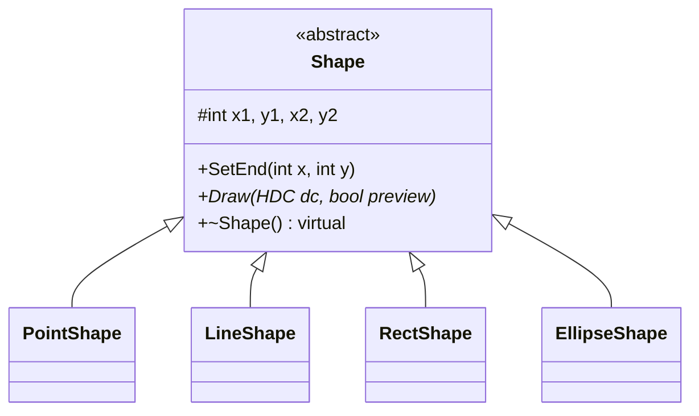

# Успадкування класів

Чотири класи перевизначають Draw. main.cpp володіє динамічним масивом Shape** pcshape на 127 елементів. Окремий вказівник draft містить поточну незавершену фігуру.
Рисунок для звіту: [class_diagram.png](Звіт/class_diagram.png).
